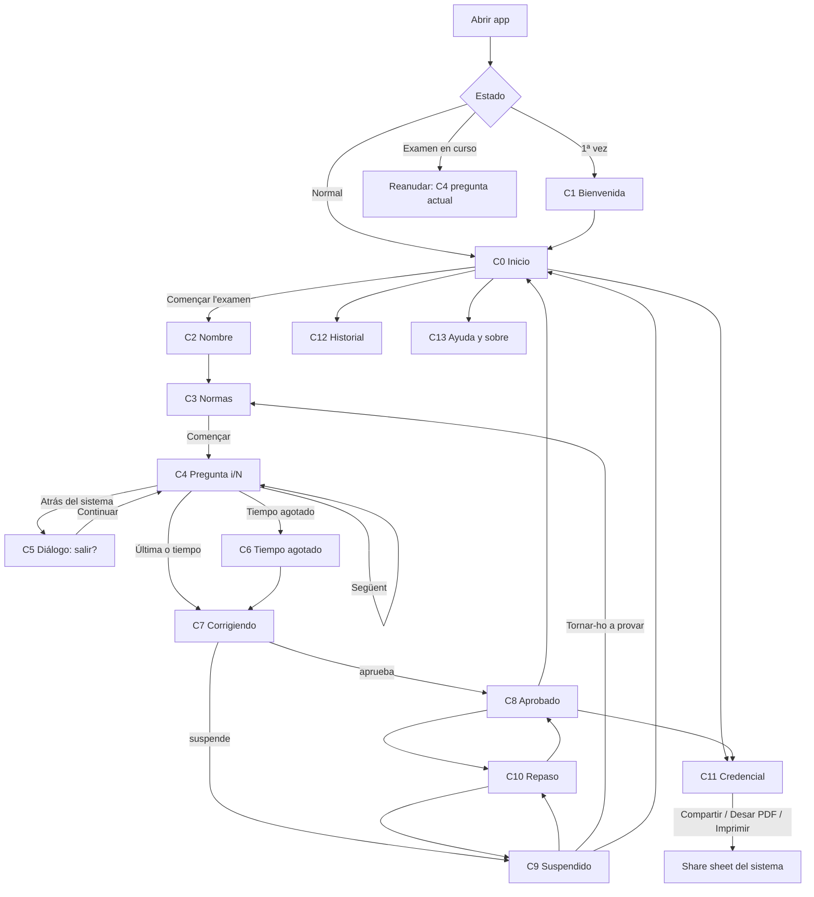
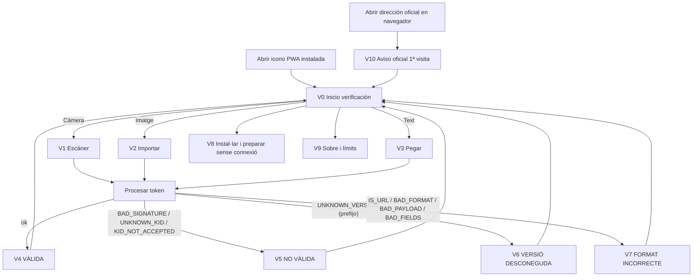

# 04 — UX/UI: app del candidato, PWA verificadora y web de descarga

> Autor: `ux-designer` · Parte de `01-requisitos.md` rev. 2, `02-credencial-y-amenazas.md`
> rev. 2, `03-arquitectura-movil.md` rev. 2, **ADR 0001** (credencial PDF+QR firmada con clave
> embebida; verificador = PWA estática pública, instalable y offline; sin app Android de
> organizadores en el MVP) y **ADR 0002** (banco fuera del repo público, inyectado en el
> build, dentro del APK). Fase de diseño: no hay código.
>
> Convención: **[H]** hecho verificado (fuente) · **[D]** decisión ya tomada (ADR/usuario) ·
> **[S]** propuesta/suposición propia · **[PV]** pendiente de verificar en prototipo.
> Idioma: documento en castellano; **todas las cadenas de UI en catalán**.
>
> **Nota de revisión (2026-11-20) — decisiones del usuario que SUSTITUYEN lo escrito más abajo.**
> Donde este documento diga «secuencial», «sin retroceso», «No podràs tornar a una pregunta
> anterior», «C5-b» (diálogo de pregunta sin respuesta) o «Roboto», manda esta nota. Detalle y
> especificación completa en `reviews/ux-review-app-m1.md` y `reviews/visual-review-app-m1.md`;
> implementado en el hito 2 de `app-candidate`:
> 1. **Navegación libre**: botones ← Anterior / Següent → abajo de C4 (sin gestos de deslizar);
>    cada selección se **guarda al instante**; en la última pregunta el botón es «Revisar i
>    finalitzar» y abre el **resumen de preguntas (C4b, pantalla nueva)**; **responder la última no
>    finaliza**: solo «Finalitzar l'examen» + confirmación con el nº de preguntas sin respuesta, o el
>    tiempo agotado. Una selección vacía = sin respuesta (también al desmarcar una múltiple).
> 2. **C5-b desaparece** (no hay diálogo «No has marcat cap resposta»). C5-a (salir) tranquiliza:
>    «Les respostes ja estan desades». C5-c muestra el recuento y su botón **seguro** («Tornar a
>    l'examen») es el primario. Atrás del sistema en la pregunta abre C5-a; en el resumen vuelve a la
>    pregunta de origen.
> 3. **Tipos de pregunta** inconfundibles: etiqueta (icono + texto), control (círculo/cuadrado),
>    panel destacado «N'hi ha més d'una resposta correcta» en la múltiple (**decisión P4: se revela**)
>    y V/F con tarjetas grandes y «Aquesta afirmació és vertadera o falsa?».
> 4. **Cronómetro** «18 min» hasta el último minuto y «mm:ss» después; la selección (azul neutro) no
>    comparte color con «correcta» (verde) del repaso.
> 5. **Tipografía**: Atkinson Hyperlegible Next/Mono (OFL, empaquetada) en lugar de Roboto, e
>    identidad provisional «Centre del camp» (pendiente de aprobación de CFBB): `docs/brand/`.

---

## 0. Resumen ejecutivo

1. **Tres superficies, tres públicos**: (a) **app Android del candidato** (examen + credencial),
   (b) **PWA verificadora** pública e instalable para organizadores, (c) **una única página
   HTML de descarga** del APK. No hay app de organizadores [D].
2. **Se diseña para mayores** (`01` §0 criterio rector): una acción principal por pantalla,
   texto base 18 sp, pregunta 22 sp, botones ≥ 56 dp, sin gestos obligatorios, mensajes que
   dicen **qué ha pasado y qué hacer**, y nunca culpan al usuario.
3. **Decisión de diseño clave sobre T5** (`02` T5: pantalla "VÀLIDA" falsa en el móvil del
   candidato): la **app del candidato nunca muestra** los textos `VÀLIDA`/`NO VÀLIDA` ni un
   check verde de "verificat". Muestra la credencial como "Credencial d'aptitud" con
   "Emesa en autoservei". Los veredictos solo existen en la PWA verificadora.
4. **Veredictos de la PWA** [D]: `VÀLIDA`, `NO VÀLIDA`, `VERSIÓ DESCONEGUDA`,
   `FORMAT INCORRECTE`. Cada uno con **icono + texto + color** (nunca solo color) y una frase
   explicativa. `VÀLIDA` siempre va acompañada de "Comprova que les dades coincideixen amb el
   document i amb la persona" y del aviso de límites (§5.6).
5. **Anti-suplantación del verificador** (§5.7): el QR es payload puro, no URL (`02` §6.4), de
   modo que **ningún enlace recibido es necesario**. El organizador instala la PWA desde la
   dirección oficial y la abre **desde su icono**; la propia PWA le recuerda esa regla.
6. **Página de descarga** (§6): un HTML estático sin JS imprescindible; qué es, botón APK,
   instrucciones de instalación de orígenes desconocidos, SHA-256, versión. Nada más.
7. **Límite honesto**: ninguna pantalla puede garantizar que la PWA no sea una copia falsa; solo
   se reduce la probabilidad (§5.7). Y la marca de integridad no es una garantía fuerte [D]
   (ADR 0001); los textos lo dicen sin tecnicismos.

---

## 1. Mapa de pantallas y navegación

### 1.1 Inventario

**App del candidato (Android, Compose; una sola Activity — `03` §0.3)**

| ID | Pantalla | Cuándo |
|---|---|---|
| C0 | Inicio | Siempre; cambia según estado (sin credencial / con credencial / examen en curso) |
| C1 | Bienvenida (solo primer uso) | 1.ª apertura |
| C2 | Nombre y apellidos | Antes de cada examen (precargado del último) |
| C3 | Normas del examen | Antes de empezar |
| C4 | Pregunta (única / múltiple / V-F) | Durante el examen |
| C5 | Diálogos: salir, finalizar, confirmar sin respuesta | Durante el examen |
| C6 | Tiempo agotado | Si expira |
| C7 | Corrigiendo (breve) | Fin del examen |
| C8 | Resultado: aprobado | Aciertos ≥ umbral |
| C9 | Resultado: suspendido | Aciertos < umbral |
| C10 | Repaso de preguntas (feedback por pregunta) | Desde C8/C9/C12 |
| C11 | Credencial (pantalla, brillo máx., compartir) | Si aprobó |
| C12 | Historial local (opcional, `01` CU-C10) | Desde C0 |
| C13 | Ayuda y sobre la app (versión, privacitat, límites de la credencial) | Desde C0 |
| C14 | Aviso de versión nueva (banner) | Si `latest.json` activo (`03` §9.2, decisión abierta) |

**PWA verificadora (navegador / instalada)**

| ID | Pantalla | Cuándo |
|---|---|---|
| V0 | Inicio de verificación (3 vías de entrada) | Siempre |
| V1 | Escáner de cámara | "Escaneja amb la càmera" |
| V2 | Importar imagen / PDF [PV: PDF] | "Tria una imatge" |
| V3 | Pegar el texto | "Enganxa el text" |
| V4 | Resultado `VÀLIDA` | Firma correcta, `kid` y versión conocidos |
| V5 | Resultado `NO VÀLIDA` | Firma incorrecta / alterada / clave no reconocida |
| V6 | Resultado `VERSIÓ DESCONEGUDA` | Prefijo `ARB` con versión no soportada (`UNKNOWN_VERSION`, `02` §3.7.8) |
| V7 | Resultado `FORMAT INCORRECTE` | No es una credencial de Arbitratge o está dañado |
| V8 | Instalar / usar sin connexió (guía) | Desde V0, pie y primera visita |
| V9 | Sobre / límits (texto de advertencia de `02` §4) | Pie |
| V10 | Aviso oficial (adreça oficial) | 1.ª visita y siempre en pie de V0 |

**Web de descarga**: una sola página (D0), §6.

### 1.2 Navegación — candidato



Reglas de navegación [S]:

- **Una sola pila lineal durante el examen** (**C4 ⇄ C4b resumen de preguntas**); el botón
  *Atrás* del sistema **no retrocede de pregunta** (para eso están Anterior/Següent; la navegación
  es **libre**, decisión 2026-11-20): en C4 abre el diálogo C5-a (§2.4); en C4b vuelve a la pregunta
  de origen.
- **Barra inferior de 2–3 destinos** solo en C0/C12/C13 (Inici · Historial · Ajuda). Durante el
  examen no hay barra: nada distrae ni permite salir por error.
- Cada pantalla de resultado y de credencial tiene un único botón primario; el resto, texto
  secundario.

### 1.3 Navegación — verificador (PWA)



---

## 2. Wireframes — app del candidato

Notación: `[ Botón ]` primario; `( Botón )` secundario; `▢/▣` casilla; `○/◉` opción única.
Todas las pantallas: título en la barra superior (top app bar), contenido con desplazamiento,
**botón primario anclado abajo** dentro de la zona del pulgar, respetando insets (edge-to-edge,
`03` §10).

### 2.1 C0 — Inicio (varios estados)

**Estado normal, sin credencial ni historial (vacío)**

```
┌──────────────────────────────────────┐
│  Arbitratge CFBB                  ⓘ  │
├──────────────────────────────────────┤
│                                      │
│   (logo CFBB)                        │
│                                      │
│   Examen per a àrbitres de           │
│   Futbol amb Botons                  │
│                                      │
│   20 preguntes · 30 minuts           │
│   Per aprovar: 14 encerts            │
│                                      │
│   Encara no has fet cap examen.      │
│   Pots practicar tantes vegades      │
│   com vulguis.                       │
│                                      │
│  ┌────────────────────────────────┐  │
│  │      Començar l'examen         │  │
│  └────────────────────────────────┘  │
│                                      │
├──────────────────────────────────────┤
│   Inici      Historial       Ajuda   │
└──────────────────────────────────────┘
```

**Estado con examen en curso (interrumpido)** — el reloj no se pausa (`01` §3.2); se dice
claro:

```
│  Tens un examen començat             │
│  Temps que et queda: 18 min          │
│  Pregunta 7 de 20                    │
│  [ Continuar l'examen ]              │
```

**Estado con credencial** — añade tarjeta superior:

```
│  ┌────────────────────────────────┐  │
│  │ ✔ Has aprovat · 17 de 20       │  │
│  │ Credencial d'aptitud           │  │
│  │ [ Mostrar la credencial ]      │  │
│  └────────────────────────────────┘  │
│  ( Tornar a fer l'examen )           │
```

Los textos "17 de 20" solo si el producto decide mostrar nota (pregunta abierta 4).

### 2.2 C1 — Bienvenida (solo primer uso, 1 pantalla)

```
┌──────────────────────────────────────┐
│  Benvingut/da                        │
├──────────────────────────────────────┤
│  Aquesta app et fa un examen del     │
│  reglament de Futbol amb Botons.     │
│                                      │
│  • Es corregeix sola, a l'instant.   │
│  • Veuràs què has fallat i quina era │
│    la resposta correcta.             │
│  • Si aproves, tindràs una           │
│    credencial per ensenyar.          │
│  • No cal connexió a internet.       │
│                                      │
│  [ Entesos ]                         │
└──────────────────────────────────────┘
```

### 2.3 C2 y C3 — Nombre y normas

```
┌──────────────────────────────────────┐
│ ←  El teu nom                        │
├──────────────────────────────────────┤
│  Escriu el teu nom i cognoms tal com │
│  vols que surtin a la credencial.    │
│  No es podrà canviar després.        │
│                                      │
│  Nom i cognoms                       │
│  ┌────────────────────────────────┐  │
│  │ Maria Puig Vila                │  │
│  └────────────────────────────────┘  │
│  Error (si buit): Escriu el teu nom  │
│  per continuar.                      │
│                                      │
│  [ Continuar ]                       │
└──────────────────────────────────────┘

┌──────────────────────────────────────┐
│ ←  Abans de començar                 │
├──────────────────────────────────────┤
│  ⏱ Tens 30 minuts en total.          │
│  ❓ Són 20 preguntes.                │
│  ✔ Per aprovar cal encertar-ne 14.   │
│  ↔ Pots anar endavant i enrere i     │
│    canviar les respostes fins que    │
│    finalitzis. (2026-11-20)          │
│  ☑ Algunes preguntes tenen més d'una │
│    resposta correcta: t'ho indicarem.│
│  ○ Les preguntes sense resposta      │
│    compten com a fallades.           │
│  Les respostes es desen automàticament│
│  ⚠ Si surts de l'app, el temps       │
│    continua passant.                 │
│                                      │
│  Nom a la credencial:                │
│  Maria Puig Vila      ( Canviar )    │
│                                      │
│  [ Començar ara ]                    │
└──────────────────────────────────────┘
```

Decisión [S]: iconos + texto (no solo icono); la lista es leída por TalkBack como lista.
Validación del nombre: no vacío, ≥ 2 caracteres; **no** rechazar acentos, espacios dobles ni
apóstrofos. [D: ADR 0001/`03`] El nombre queda sellado en la credencial y **no se edita**.
**Decisión de UX (I2):** el nombre se **confirma antes de empezar el examen**, en C3
("Nom a la credencial: … ( Canviar )", que vuelve a C2), y queda congelado al pulsar
"Començar ara". Así, cuando el candidato aprueba, `03` puede emitir/sellar inmediatamente sin
paso extra ni intervención externa (§2.7). Esta es la transición vigente de UX; `03` se
alineará con ella (nombre confirmado antes de empezar y congelado). Si el nombre se cambia después, solo cabe repetir el
examen.

### 2.4 C4 — Pregunta (3 variantes) y diálogos

> **Todos los enunciados y respuestas de estos wireframes son ficticios** y no pertenecen
> al banco del examen.

**Estructura común**: barra superior con "Pregunta 7 de 20" y el **tiempo restante** en texto
(no solo barra). Debajo, una barra de progreso lineal (decorativa para TalkBack).

**Opción única** (`single_choice`)

```
┌──────────────────────────────────────┐
│  Pregunta 7 de 20        ⏱ 18:42     │
│  ▓▓▓▓▓▓▓░░░░░░░░░░░░░                │
├──────────────────────────────────────┤
│  Quants corns pot tenir un unicorn   │
│  de prova?                         │
│                                      │
│  Tria una resposta.                  │
│  ┌────────────────────────────────┐  │
│  │ ○  Cap                        │  │
│  └────────────────────────────────┘  │
│  ┌────────────────────────────────┐  │
│  │ ◉  Un                        │  │
│  └────────────────────────────────┘  │
│  ┌────────────────────────────────┐  │
│  │ ○  Tres                         │  │
│  └────────────────────────────────┘  │
│                                      │
│  [ Següent ]                         │
└──────────────────────────────────────┘
```

**Respuesta múltiple** (`multiple_choice`, ≥ 2 correctas) — el cambio de forma
(casillas cuadradas) **y** el texto de ayuda marcan que se pueden elegir varias:

```
│  Pregunta 12 de 20       ⏱ 09:05     │
│  ...                                 │
│  Quins elements són un codi de prova? │
│                                      │
│  Marca totes les respostes correctes.│
│  Pots marcar-ne més d'una.           │
│  ┌────────────────────────────────┐  │
│  │ ▣  Fletxa nord                      │  │
│  └────────────────────────────────┘  │
│  ┌────────────────────────────────┐  │
│  │ ▢  Cercle blau                   │  │
│  └────────────────────────────────┘  │
│  ┌────────────────────────────────┐  │
│  │ ▣  Estrella verda                    │  │
│  └────────────────────────────────┘  │
│  2 respostes marcades                │
│  [ Següent ]                         │
```

No se revela el número exacto de correctas [S] (la regla es "conjunto exacto", `01` §1.3);
si el producto prefiere "Marca'n 2", es cambio de microcopy (pregunta abierta 6).
**Actualización 2026-11-20 (P4):** SÍ se dice que «N'hi ha més d'una resposta correcta» (verdad
según el banco: `multiple_choice` ≥ 2) en un panel destacado, con el contador vivo «N respostes
marcades»; la frase «Pots marcar-ne més d'una» deja de ser la única pista. En lugar de «[ Següent ]»
solo, la barra inferior lleva ← Anterior y Següent → (ver nota de revisión al inicio).

**Verdadero/Falso** (`true_false`): mismas tarjetas, 2 opciones ("Vertader"/"Fals",
literales del banco base).

**Estados de C4**

| Estado | Diseño |
|---|---|
| **Sin respuesta marcada** | ~~Diálogo C5-b~~ **(sustituido 2026-11-20)**: "Següent" **avanza sin diálogo**; la pregunta queda «Sense resposta» (cuenta como fallada). El aviso pasa al resumen (C4b) y a la confirmación final con el recuento. |
| **Respuesta guardada** | Solo cuando el guardado ha **confirmado** (`03`: persistir antes de avanzar), tras "Següent", transición breve (≤ 150 ms; sin animación si "reduir animacions") y foco de TalkBack a la nueva pregunta. |
| **Última pregunta** | **(2026-11-20)** El botón dice «Revisar i finalitzar» y abre el resumen (C4b); **responder la última no finaliza**. «Finalitzar l'examen» está en el resumen y pide confirmación. |
| **Cargando** | No hay carga perceptible (todo local). Si Room tarda > 300 ms al reanudar, indicador circular + "Recuperant el teu examen…". |
| **Error de persistencia (B3)** | **No se avanza ni se finaliza** con una respuesta sin guardar. Se reintenta una vez en silencio; si falla, la pregunta y la respuesta marcada **siguen visibles** y aparece un aviso en la propia pantalla (diálogo, no solo banner) con [ Tornar-ho a provar ] y ( Sortir de l'examen ). El reloj sigue según la política de `03`. Si no se puede recuperar, se ofrece abandonar o reintentar; **nunca se emite una credencial con datos incompletos** (ver §2.10). |
| **Tiempo agotándose** | Ver abajo. |

**Tiempo agotándose** (umbrales 5 min y 1 min, `01` §3.1 paso 4):

```
┌──────────────────────────────────────┐
│  Pregunta 17 de 20       ⏱ 04:59     │  ← fondo ámbar, texto oscuro
│  ┌────────────────────────────────┐  │
│  │ ⚠ Et queden 5 minuts.          │  │  ← banner, descartable
│  └────────────────────────────────┘  │
│  ...                                 │
│  Pregunta 19 de 20       ⏱ 00:59     │  ← fondo rojo, texto blanco
│  ┌────────────────────────────────┐  │
│  │ ⚠ Només queda 1 minut.         │  │
│  └────────────────────────────────┘  │
```

- **No** hay parpadeo ni segundos "saltando" en pantalla (ansiedad, epilepsia fotosensible);
  el cronómetro cambia de color y añade el icono ⚠ en los dos umbrales. Antes de 1 min, se
  muestra `mm:ss`; antes, `mm min`.
- **TalkBack**: el cronómetro **no** se anuncia cada segundo. Los banners de 5 min y 1 min
  se anuncian una vez (`liveRegion = assertive`); el usuario puede consultar el tiempo
  tocando el cronómetro ("Et queden 18 minuts i 42 segons").
- **Vibración corta** en los dos umbrales (opcional, respeta ajustes del sistema).
- **Ocultar el tiempo** [S]: botón "Amagar el temps" en el cronómetro (el reloj sigue y los
  avisos se mantienen). Ayuda a usuarios que se bloquean al ver la cuenta atrás.

**Diálogos (C5)**

```
C5-a  Atrás del sistema / botón "Sortir"
┌──────────────────────────────────┐
│  Vols sortir de l'examen?        │
│  El temps continua passant.      │
│  Pots tornar a obrir l'app i     │
│  continuar.                      │
│  ( Sortir )   [ Continuar ]      │
└──────────────────────────────────┘
C5-b  ELIMINADO (2026-11-20): ya no hay diálogo al pulsar "Següent" sin respuesta.
C5-c  "Finalitzar l'examen" (solo desde el resumen C4b)
┌──────────────────────────────────┐
│  Vols finalitzar l'examen?       │
│  Tens 3 preguntes sense resposta:│
│  comptaran com a fallades.       │   (o: «Has respost totes les preguntes.»)
│  Després de finalitzar ja no     │
│  podràs canviar cap resposta.    │
│  [ Tornar a l'examen ]           │   ← seguro = primario
│  ( Finalitzar )                  │
└──────────────────────────────────┘
C5-d  Fallo de desat (modal, no cerrable): «No s'ha pogut desar» (selección) o
      «No s'ha pogut finalitzar» (cierre). [ Tornar-ho a provar ] ( Sortir de l'examen ).
C4b   Resum de preguntes: lista «Pregunta N · Resposta desada / Sense resposta · Ets aquí» con la
      1.ª línea del enunciado, cronómetro y avisos activos, «Anar a la primera sense resposta» y
      «Finalitzar l'examen». Tocar una fila va a esa pregunta (con la selección ya guardada).
```

En los diálogos el **botón seguro es el primario** (continuar el examen / volver al examen);
la acción irreversible es secundaria. C5-a (salir) dice ahora: «El temps continua passant. Les
respostes ja estan desades: quan tornis a obrir l'app, podràs continuar.» con «Continuar l'examen»
como primario.

### 2.5 C6 — Tiempo agotado

```
┌──────────────────────────────────────┐
│  S'ha acabat el temps                │
├──────────────────────────────────────┤
│  ⏱ Has contestat 16 de 20 preguntes. │
│  Les 4 que falten comptaran com a    │
│  fallades.                           │
│                                      │
│  [ Veure el resultat ]               │
└──────────────────────────────────────┘
```

Si la app se abre con el examen ya expirado (cierre prolongado) se muestra la misma pantalla
con "El temps ja s'havia acabat mentre eres fora."

### 2.6 C7 — Corrigiendo

```
│   ◌ (indicador circular)             │
│   Corregint l'examen…                │
```

Local, normalmente < 1 s. Si se muestra, mínimo 400 ms para evitar parpadeo. Es el único
"cargando" del flujo del candidato, junto con la generación de PDF (§3.5).

### 2.7 C8 — Resultado: aprobado

```
┌──────────────────────────────────────┐
│  Resultat                            │
├──────────────────────────────────────┤
│        ✔                             │
│   HAS APROVAT                        │
│                                      │
│   Encerts: 17 de 20                  │
│   Fallades: 3                        │
│   Mínim per aprovar: 14              │
│   Temps: 22 min 10 s                 │
│                                      │
│   La teva credencial ja està         │
│   preparada.                         │
│                                      │
│  [ Veure la credencial ]             │
│  ( Repassar les 3 preguntes fallades)│
│  ( Tornar a l'inici )                │
└──────────────────────────────────────┘
```

El nombre ya se confirmó antes del examen (§2.3), por lo que **no hay paso extra antes de
sellar**; la credencial se emite al corregir un aprobado, solo si el resultado y la
credencial se han **guardado correctamente** (§2.10). Aprobado con 0 fallos: "Cap fallada. Enhorabona!" y se oculta "Repassar".

### 2.8 C9 — Resultado: suspendido

```
┌──────────────────────────────────────┐
│  Resultat                            │
├──────────────────────────────────────┤
│   NO HAS APROVAT, DE MOMENT          │
│                                      │
│   Encerts: 11 de 20                  │
│   Fallades: 9                        │
│   Mínim per aprovar: 14              │
│   Et van faltar 3 encerts.           │
│                                      │
│   Repassa les teves fallades: així   │
│   aprendràs el reglament.            │
│                                      │
│  [ Repassar les 9 fallades ]         │
│  ( Tornar-ho a provar )              │
│  ( Tornar a l'inici )                │
└──────────────────────────────────────┘
```

Tono: "de moment", sin rojo agresivo ni iconos de "error": suspender es parte del aprendizaje
(`01` §0.2). Color: primario neutro con icono ℹ; el rojo se reserva a errores del sistema.
El botón primario es **repasar**, no reintentar.

### 2.9 C10 — Repaso de preguntas (feedback)

Lista y detalle. El feedback educativo [D] se muestra para todas las **fallades**; las
acertadas son accesibles con un filtro "Totes / Fallades" (por defecto, Fallades; la decisión
editorial de mostrar las acertadas está abierta, `01` pregunta 4).

```
┌──────────────────────────────────────┐
│ ←  Repàs                             │
│  ( Fallades 3 )  ( Totes 20 )        │  ← segmented buttons
├──────────────────────────────────────┤
│  Pregunta 4 · Fallada                │
│  [FICTICI] Quants corns pot tenir…          │
│                              ›       │
│  Pregunta 9 · Fallada                │
│  …                                   │
└──────────────────────────────────────┘

┌──────────────────────────────────────┐
│ ←  Pregunta 4 de 20 · Fallada        │
├──────────────────────────────────────┤
│  Quants corns pot tenir un unicorn   │
│  de prova?                         │
│                                      │
│  La teva resposta                    │
│  ✖ Tres                               │
│  La resposta correcta                │
│  ✔ Un                              │
│                                      │
│  Per què?                            │  ← solo si hay `explanation`
│  Unicorn és un exemple fictici…       │
│                                      │
│  ( ‹ Anterior )     ( Següent › )    │
└──────────────────────────────────────┘
```

- En respuesta múltiple se listan **todas** las marcadas y todas las correctas, cada una con
  ✔/✖ + texto ("Correcta, la vas marcar", "Correcta, no la vas marcar", "Incorrecta, la vas
  marcar").
- Sin `explanation`: se oculta el bloque "Per què?" y no se deja hueco ni "No disponible".
- Pregunta sin respuesta: "No vas respondre aquesta pregunta."
- Botón "Anterior/Següent" visibles (aquí **sí** se puede ir atrás: ya no hay examen).
- **Capturas permitidas** (sin `FLAG_SECURE`, `01` §3.2).

### 2.10 Pantallas de error generales (candidato)

| Situación | Diseño |
|---|---|
| Estado del examen ilegible (corrupción) | Pantalla completa: "No hem pogut recuperar l'examen. Pots començar-ne un de nou." + [ Començar de nou ]. No se culpa al usuario. |
| Fallo al **guardar el resultado** (C7) | No se muestra C8/C9 ni se da por finalizado. Pantalla C7 con error: "No hem pogut desar el resultat. Allibera espai al mòbil i torna-ho a provar." [ Tornar-ho a provar ] ( Abandonar l'examen ). Las respuestas siguen en el estado persistido; no hay credencial hasta que el resultado se guarde. |
| Sin espacio / fallo de almacenamiento al **emitir** la credencial | "No hem pogut guardar la credencial. Allibera espai al mòbil i torna-ho a provar." [ Tornar-ho a provar ] ( Abandonar ). Se regenera desde el estado persistido (`03`); nunca se emite desde datos incompletos. Se muestra "Has aprovat" solo si el resultado está guardado; si falta la credencial, C8 indica "Encara no s'ha pogut crear la credencial" con el reintento. [PV] probar fallo al guardar respuesta, resultado y emisión. |
| Fallo al generar PDF | Ver §3.5. |
| Banco/ajustes inválidos (build roto) | "Aquesta versió de l'app té un problema. Descarrega l'última versió." + enlace a la página de descarga. (Caso interno, no esperado.) |
| Sin `INTERNET`/sin red al buscar actualización | **No se muestra error**: la consulta es silenciosa y opcional (`03` §9.2). |

### 2.11 C11–C13 → ver §3 (credencial) y §2.12

### 2.12 C12 y C13 — Historial y Ayuda

- **C12 Historial** (opcional [S]): lista de intentos (fecha del dispositiu, aciertos/N, estado).
  **Vacío**: "Encara no has fet cap examen. Quan en facis un, apareixerà aquí." Tocar un
  intento abre su repaso (C10). Botón "Esborrar l'historial" con confirmación.
- **C13 Ayuda y sobre**: versión de la app, "Com instal·lar una actualització", **privacitat**
  (text de §7.6: dades locals, QR llegible, còpies exportades, consulta de versió), y el bloque "Sobre la credencial" con la
  advertencia de `02` §4 en lenguaje sencillo (§7.6). Sin jerga: no aparece "firma ECDSA".

---

## 3. Presentación y compartición de la credencial

Esquema (ADR 0001, `02` §7.1, `03` §6): PDF A4 + imagen con texto legible + **QR sellado**
(token `ARB1.<payload>.<sello>`) que contiene nombre, resultado, versión de examen, fecha del
dispositivo, `credential_id`, `orig = autoservei`. **ARB1 no emite `exp`/caducidad en el MVP**
(`exp` solo está reservado, `02`); no se muestra ninguna fecha de caducidad (ver §3.7, fase futura).

### 3.1 Principios

1. **La credencial legible a simple vista es el mínimo viable** (`01` CU-O2): texto grande,
   en catalán, comprensible sin verificador.
2. **No simular verificación en la app del candidato** (T5): sin check verde, sin "VÀLIDA".
   Se usa el rótulo neutro **"Credencial d'aptitud"** y la etiqueta fija "Emesa en autoservei".
3. **Nunca** se escribe "certificat", "signatura digital segura" ni "autèntica" (`02` §4).
4. El QR es el elemento de mayor tamaño que cabe y con **zona de silencio** de ≥ 4 módulos;
   contraste negro puro sobre blanco puro también en tema oscuro (el QR **siempre** sobre
   fondo blanco).

### 3.2 Pantalla C11 — Credencial en pantalla

```
┌──────────────────────────────────────┐
│ ←  La teva credencial            ⋮   │
├──────────────────────────────────────┤
│  CREDENCIAL D'APTITUD                │
│  Àrbitre de Futbol amb Botons · CFBB │
│                                      │
│  Maria Puig Vila                     │  ← 28 sp, negreta
│                                      │
│  Resultat: APTA                      │
│  Examen: reglament v2026.1           │
│  Data del dispositiu: 20/11/2026     │
│  Codi: A7C4-19DE                     │  ← código corto: 8 hex, XXXX-XXXX
│                                      │
│  ┌────────────────────────┐          │
│  │  ▓▓ ▓ ▓▓▓ ▓ ▓▓ ▓▓       │          │
│  │  ▓ ▓▓  ▓▓ ▓▓▓ ▓        │          │  ← QR grande, fondo blanco
│  │  (QR)                   │          │
│  └────────────────────────┘          │
│  Emesa en autoservei. La comprova    │
│  un organitzador amb el verificador  │
│  oficial.                            │
│                                      │
│  [ Mostrar a un organitzador ]       │
│  ( Compartir )  ( Desar PDF )        │
│  ( Imprimir )                        │
└──────────────────────────────────────┘
```

Concordancia de género: "APTE/APTA" requeriría un dato de género que **no se recoge** [S].
Se propone el neutro **"Resultat: APTE"** como valor del campo `res` (ya definido como "APTE"
en `02` §7.1) y evitar flexión en la UI propia. Pregunta abierta 3.

### 3.3 "Mostrar a un organitzador" — modo presentación (QR en pantalla)

Botón que abre una vista a pantalla completa:

```
┌──────────────────────────────────────┐
│                           ( Tancar ) │
│                                      │
│       ┌──────────────────────┐       │
│       │                      │       │
│       │        (QR)          │       │  ← ocupa ≥ 80 % del ancho
│       │                      │       │
│       └──────────────────────┘       │
│                                      │
│   Maria Puig Vila                    │
│   APTE · reglament v2026.1           │
│   Codi: A7C4-19DE                    │
│                                      │
│   Emesa en autoservei                │
└──────────────────────────────────────┘
```

- **Brillo al máximo** mientras la vista está abierta: `window.attributes.screenBrightness =
  1f` y `FLAG_KEEP_SCREEN_ON`, **restaurados** al cerrar (`onStop` incluido). No requiere
  permiso [S, API estándar de `WindowManager.LayoutParams`; **[PV]** comprobar comportamiento
  en dispositivos de gama baja].
- **Fondo siempre blanco** para el QR, texto negro; zona de silencio.
- **Sin captura de pantalla bloqueada** (no `FLAG_SECURE`).
- **Pantalla fija**: la rotación no cambia el contenido; el QR se reajusta.
- **Sin caducidad en el MVP**: ARB1 no lleva `exp`; no se muestra "Caduca" ni aviso de caducada
  (ver §3.7, fase futura).
- **Información de ayuda al organizador** (debajo, pequeña): "Per verificar-la: obre
  l'adreça oficial del verificador al teu mòbil" (sin enlazar: ver §5.7), sin URL clicable.

### 3.4 Compartir, guardar, imprimir

| Acción | Mecanismo [S] (`03` §6) | UX |
|---|---|---|
| **Compartir** | *Share sheet* del sistema con `FileProvider`; envía **PDF** y/o PNG | Primera opción: PDF. Texto del mensaje precargado: "La meva credencial d'àrbitre (CFBB). Comprova-la amb el verificador oficial." — **sin enlace**, para no entrenar al organizador a abrir enlaces (§5.7). |
| **Desar PDF** | `ACTION_CREATE_DOCUMENT` (el usuario elige carpeta; sin permisos) | Tras guardar: "Desat" + el nombre del archivo y, solo si el sistema lo informa con fiabilidad, el destino elegido (no se afirma "Descàrregues") + [ Obrir ] cuando haya URI abrible. |
| **Imprimir** | `PrintManager`/Android Print Framework sobre el PDF [PV] | Alternativa: guardar y abrir con otra app. |
| **Guardar imagen (PNG)** | Share/guardar | Útil para WhatsApp: se avisa de que **WhatsApp comprime** y puede degradar el QR (ver abajo). |

**Aviso de compresión (importante para este público)**: WhatsApp y similares recomprimen
imágenes; un QR de ~400 caracteres puede dejar de leerse [PV: medir]. Por eso: (1) el PDF es la
vía recomendada para enviar; (2) si se comparte PNG, la app dice "Per enviar-la per
WhatsApp, millor com a document (PDF)"; (3) el verificador acepta **texto pegado** como
respaldo (§5.5) y la credencial incluye el token en texto **copiable** ("Copiar el codi de
verificació").

### 3.5 Estados de la presentación

| Estado | UI |
|---|---|
| **Cargando (generando PDF)** | Diálogo no cancelable con indicador: "Preparant el document…" (< 2 s esperado, [PV]). |
| **Error al generar PDF** | "No s'ha pogut crear el PDF. Pots tornar-ho a provar o ensenyar la credencial a la pantalla." [ Tornar-ho a provar ] ( Mostrar a pantalla ). La pantalla siempre es la salida segura. |
| **Sin app para abrir PDF** | "Al teu mòbil no hi ha cap app per obrir PDFs. Pots enviar-lo igualment o ensenyar la credencial a la pantalla." |
| **Sin credencial (suspendido o aún no examinado)** | Vacío: "Encara no tens cap credencial. Aprova l'examen per aconseguir-la." [ Començar l'examen ] |
| **Reexamen: varias credenciales** | La más reciente arriba; antiguas en "Historial", etiquetadas "Anterior". |

### 3.6 Diseño del PDF/imagen exportado (A4)

*(El «Codi» corto es el `credential_id` en 8 hex agrupados `XXXX-XXXX`, p. ej. `A7C4-19DE`.)*

```
┌─────────────────────────────────────────┐
│ [logo CFBB]   CREDENCIAL D'APTITUD      │
│ Àrbitre de Futbol amb Botons            │
│─────────────────────────────────────────│
│  Maria Puig Vila                        │  ← 28 pt
│  Resultat: APTE                         │
│  Examen: reglament v2026.1              │
│  Data (del dispositiu): 20/11/2026      │
│  Codi: A7C4-19DE                        │
│                         ┌────────────┐  │
│  EMESA EN AUTOSERVEI    │            │  │
│                         │     QR     │  │  ← ≥ 5 × 5 cm
│  Aquesta credencial no  │            │  │
│  és un certificat oficial└────────────┘ │
│  ni una garantia forta.                 │
│                                         │
│  COM COMPROVAR-LA                       │
│  1. Obre l'adreça oficial del           │
│     verificador (la sap l'organització) │
│  2. Escaneja el QR                      │
│  3. Comprova que el nom coincideix      │
│─────────────────────────────────────────│
│  Codi de verificació (per copiar):      │
│  ARB1.eyJ2IjoxLC… (texto en monoespacio,│
│  partido en líneas, fuente ≥ 8 pt)      │
└─────────────────────────────────────────┘
```

- Impresión **en blanco y negro** debe seguir siendo legible: ningún significado depende del
  color. QR ≥ 4,5 cm de lado [PV: medir con tamaño final].
- El texto largo de "Codi de verificació" es respaldo para pegar en la PWA si la cámara
  falla. **[PV]**: legibilidad de un token de ~400 caracteres impreso; si no es práctico, se
  omite en papel y se queda solo en el PDF digital copiable.

### 3.7 Caducidad — fase futura (fuera del MVP)

ARB1 reserva `exp` pero **no lo emite** (`02`). Por tanto, ninguna pantalla del MVP (C11, modo
presentación, PDF, V4) muestra "Caduca"/"Caducitat" ni avisos de caducada. Si una versión
futura del formato lo añade, se diseñará entonces (línea de fecha + política de veredicto).
---

## 4. Flujo del candidato de extremo a extremo (resumen)

1. Recibe el enlace de la **web de descarga** (§6) por WhatsApp/correo del club.
2. Descarga, instala (orígenes desconocidos), abre.
3. C1 → C0 → C2 → C3 → C4 × N → C7 → C8/C9.
4. Si aprueba: C11 → "Mostrar a un organitzador" / PDF.
5. En el torneo, el organizador abre su PWA (§5) y escanea el QR en la pantalla o en el papel.

Puntos de abandono previstos y su mitigación: instalación del APK (§6.3), miedo a "fallar" el
reloj (§2.4 ocultar tiempo, no culpabilizar), pérdida del PDF (copia siempre en la app,
exportable de nuevo, `01` CU-C9).

---

## 5. PWA verificadora pública

> [D] ADR 0001: PWA estática y pública (GitHub Pages u hosting estático), manifiesto +
> service worker, offline tras la primera carga, comparación de datos, 4 veredictos, sin
> backend, sin secretos (solo claves públicas por `kid`). Sin app Android de organizadores.

### 5.1 Hechos técnicos que condicionan la UX [H/PV]

- **Cámara en navegador** exige contexto seguro (HTTPS) — GitHub Pages lo es
  (<https://developer.mozilla.org/docs/Web/API/MediaDevices/getUserMedia>) [S, no re-leído
  en esta sesión].
- **`BarcodeDetector`** (detector nativo de QR) no está disponible en todos los navegadores
  (Chrome en Android sí en general; Firefox y Safari no) [S, **PV** en caniuse]. La PWA debe
  llevar **su propia librería de lectura de QR** empaquetada (p. ej. jsQR o zxing-wasm,
  elección de `mobile-architect`/implementación) para que funcione sin depender del navegador.
- **Instalación**: Chrome/Edge en Android ofrecen "Instal·lar app / Afegeix a la pantalla
  d'inici" si hay manifiesto + service worker + HTTPS; el evento `beforeinstallprompt` **no**
  existe en iOS/Safari ni Firefox; ahí es "Compartir → Afegir a la pantalla d'inici" manual
  [S/PV].
- **Offline**: el service worker precachea HTML/CSS/JS/librería QR/claves públicas; solo cuando
  la caché está **completa** («preparat», §5.8) funciona sin red; la caché puede borrarse
  (el navegador o el usuario) y entonces vuelve a «no preparat». Las **actualizaciones** del SW siguen "update on next
  visit"; hay que decidir cómo avisar de una versión nueva (§5.9).
- **iOS**: la PWA es el único camino de verificación en iPhone (el candidato solo tiene APK).
  Safari iOS puede purgar la caché de sitios poco usados [PV]; se avisa en la guía.
- **No se pueden confiar** en capturas de la pantalla del candidato (T5): la regla "verifica
  siempre en **tu** móvil" va escrita en la PWA.

### 5.2 V0 — Inicio de verificación

```
┌──────────────────────────────────────┐
│ Verificador de credencials · CFBB    │
│ ┌──────────────────────────────────┐ │
│ │ ⓘ Adreça que fas servir:          │ │  ← location.host real; NO autentica
│ │ {host}                           │ │
│ │ Compara-la amb la que t'ha donat │ │
│ │ el CFBB.                         │ │
│ └──────────────────────────────────┘ │
├──────────────────────────────────────┤
│  Comprova una credencial d'àrbitre.  │
│                                      │
│  [ 📷  Escaneja amb la càmera ]      │
│  ( 🖼  Tria una imatge del mòbil )   │
│  ( 📋  Enganxa el text )             │
│                                      │
│  Estat sense connexió: {estat}       │  ← «Preparat» solo con caché completa
│  ( Instal·lar i preparar )           │
│                                      │
│  ⚠ Obre sempre aquest verificador    │
│  des de la seva icona o escrivint    │
│  l'adreça. No facis servir enllaços  │
│  rebuts per missatge.                │
│                                      │
│  Sobre els límits · Versió 1.0.0     │
└──────────────────────────────────────┘
```

Estados de V0:

| Estado | UI |
|---|---|
| **Primera visita, navegador (no instalada), con red** | Banner superior: "Instal·la el verificador al teu mòbil per fer-lo servir sense connexió" + [ Instal·lar ] (si `beforeinstallprompt`) o [ Com fer-ho ] (guía manual). Descartable, reaparece tras 7 días [S]. |
| **Instalada (display: standalone)** | No hay barra de direcciones; el host sigue en la tarjeta. Sin banner de instalación. «Instal·lada» **no** implica «preparada»: la línea de estado sin conexión se rige por la tabla de abajo. |
| **Offline: no preparat** (caché incompleta o sin comprobar) | "Sense connexió: encara no està preparat" + [ Preparar ] (con red). Sin promesa de funcionamiento. |
| **Offline: preparat** | "Preparat per fer-lo servir sense connexió" **solo** si el service worker ha terminado de cachear **todos** los ficheros del manifiesto de hashes del despliegue (`05` §6.7; `03` precache). Se re-comprueba al abrir; si falta algo vuelve a «no preparat». |
| **Offline** | Etiqueta "Sense connexió" (informativa, no un error). Si está «preparat», todo funciona; si no, se aplica la fila «no preparat». La caché puede borrarse, así que se re-comprueba. |
| **Cargando (primera carga)** | Esqueleto simple + "Carregant el verificador…". Si no cabe en caché: "Per fer-lo servir sense connexió, obre'l un cop amb internet." |
| **Navegador sin cámara/permiso denegado** | Ver V1; las otras 2 vías siguen disponibles. |

### 5.3 V1 — Escaneo por cámara

```
┌──────────────────────────────────────┐
│ ←  Escaneja el QR                    │
├──────────────────────────────────────┤
│  ┌────────────────────────────────┐  │
│  │                                │  │
│  │      (vídeo de la càmera)      │  │
│  │      ┌ ─ ─ ─ ─ ─ ─ ─ ┐         │  │
│  │      │  marc guia    │         │  │
│  │      └ ─ ─ ─ ─ ─ ─ ─ ┘         │  │
│  └────────────────────────────────┘  │
│  Apunta la càmera al codi QR de la   │
│  credencial. Mantén el mòbil quiet.  │
│                                      │
│  ( 💡 Llanterna )  ( Cancel·lar )    │  ← linterna solo si el navegador la ofrece
└──────────────────────────────────────┘
```

| Estado | Mensaje |
|---|---|
| **Pidiendo permiso** | Antes de la petición del sistema, pantalla explicativa: "Necessitem la càmera només per llegir el QR. No es desa ni s'envia cap imatge." [ Continuar ] |
| **Permiso denegado** | "No tenim permís per usar la càmera. Pots activar-lo als ajustos del navegador o triar una de les altres opcions." [ Tria una imatge ] [ Enganxa el text ] |
| **Sin cámara / no soportada** | "Aquest dispositiu no permet escanejar des del navegador." + mismas alternativas. |
| **No encuentra QR** (> 10 s) | "No trobem cap QR. Allunya o acosta el mòbil, i evita reflexos." + sugerir "Pots triar una imatge o enganxar el text." |
| **Encontrado** | Vibración corta + paso inmediato a resultado (sin botón extra). |
| **Cámara en uso por otra app** | "No s'ha pogut obrir la càmera. Tanca altres apps que la facin servir i torna-ho a provar." |

La lectura es local por diseño (sin backend, [D]). **[PV]** Que ningún contenido de la credencial
ni imagen salga del dispositivo (ninguna petición de red con ellos, ni terceros, ni logs) debe
comprobarse inspeccionando el tráfico de la PWA antes de afirmarlo en pantalla. Hasta entonces
el texto dice "La credencial es comprova en aquest dispositiu" (`v_local`), sin "no s'envia
cap dada". La propia carga/actualización de la PWA sí contacta con el hosting (el host ve IP y
recursos pedidos, no la credencial).

### 5.4 V2 — Importar imagen

```
│ ←  Tria una imatge                   │
│  Tria una captura o una foto on es   │
│  vegi el QR de la credencial.        │
│  [ Triar imatge ]                    │
│  (PDF: "Si tens el PDF, fes-ne una   │
│   captura i tria-la aquí.")          │
```

- Lectura del QR desde imagen con la misma librería (decodificación en `canvas`).
- Importar **PDF** directamente exigiría un renderizador (pdf.js, peso alto): **[PV]**, no en
  el MVP; se dice "fes-ne una captura" [S]. Pregunta abierta 5.
- Errores: "No hem trobat cap QR en aquesta imatge. Prova amb una imatge més nítida o
  enganxa el text." → V7 solo si hay contenido que no es nuestro formato.
- Si la imagen vino de WhatsApp (comprimida): mensaje específico opcional: "Si l'has rebut per
  WhatsApp, demana el PDF original."

### 5.5 V3 — Pegar texto

```
│ ←  Enganxa el text                   │
│  Enganxa aquí el codi de verificació │
│  que apareix a la credencial.        │
│  ┌────────────────────────────────┐  │
│  │ ARB1.eyJ2…                     │  │  ← textarea, monoespacio, 6 líneas
│  └────────────────────────────────┘  │
│  ( Enganxar des del porta-retalls )  │
│  [ Comprovar ]                       │
```

- "Enganxar des del porta-retalls" usa `navigator.clipboard.readText()` (requiere gesto y
  permiso; si falla, el usuario pega a mano) [PV].
- **Normalización**: la PWA aplica **exactamente** la función única de `02` §3.7.7, la misma
  que para cámara e imagen: (1) entrada bruta > 2048 unidades UTF-16 ⇒ `FORMAT INCORRECTE`;
  (2) se eliminan **todas** las apariciones, en cualquier posición, de U+0009, U+000A, U+000D,
  U+0020, U+00A0, U+200B y U+FEFF; (3) **nada más** (ni mayúsculas, ni Unicode, ni guiones,
  ni caracteres parecidos); (4) resultado vacío ⇒ `FORMAT INCORRECTE`. La UI **no** recorta,
  reescribe ni "arregla" nada por su cuenta (p. ej. no quita guiones ni cambia `arb1.`) y no
  muestra el texto normalizado como si fuera el original. Después delega en el orden de
  verificación de `02` §3.7.8 (prefijo `http(s)://` ⇒ V7 con mensaje de enlace, §5.6).
- El resultado de cualquier fallo se traduce con la tabla de `02` §3.7.8; esta pantalla no
  inventa códigos.
- Corolario para el emisor (`02` §3.7.7): el token impreso en varias líneas se parte solo con
  saltos de línea, nunca con guion.
- Estado vacío: botón "Comprovar" deshabilitado y `aria-describedby` explicando por qué.

### 5.6 V4–V7 — Resultados inequívocos

**Principios** [S]:

1. Una **pantalla completa de resultado**, no un texto en la misma pantalla.
2. Estructura fija: **icono grande + palabra en mayúsculas + frase + datos + acción**.
3. **Nunca solo color**: el icono, el texto y el contorno cambian (✔ / ✖ / ? / ⚠).
4. Fondos con contraste ≥ 4,5:1 (texto blanco sobre #1B5E20-ish verde, #B3261E rojo,
   #5F6368 gris, #8A5A00 ámbar; **[PV]** calcular exacto en implementación).
5. Los textos `VÀLIDA`/`NO VÀLIDA` son los de [D] ADR 0001; la frase de debajo aclara el
   alcance (evita el sobre-entendimiento de "autèntica", `02` §4).
6. **Siempre muestra los datos decodificados** (excepto V7), en letra grande, **antes** de
   cualquier botón: nombre, resultado, versión de examen, fecha del dispositivo,
   código corto. El organizador compara con el documento/persona.

**V4 — `VÀLIDA`**

```
┌──────────────────────────────────────┐
│          ✔                           │  ← fondo verde oscuro, texto blanco
│        VÀLIDA                        │
│  El codi no ha estat alterat.        │
├──────────────────────────────────────┤
│  Nom                                 │
│  Maria Puig Vila                     │
│  Resultat           APTE             │
│  Examen             reglament v2026.1│
│  Data del dispositiu 20/11/2026      │
│  Codi               A7C4-19DE        │
│  Emissió            Autoservei       │
├──────────────────────────────────────┤
│  ☐ El nom coincideix amb el document │  ← opcional, no condiciona nada
│  ☐ El nom coincideix amb la persona  │
│                                      │
│  ⚠ Credencial emesa en autoservei.   │
│  La marca detecta canvis casuals;    │
│  no és una prova contra un mòbil o   │
│  una app modificats.                 │
│                                      │
│  [ Comprovar una altra credencial ]  │
└──────────────────────────────────────┘
```

- Las casillas de comparación son **ayuda visual** (check manual local, no se guarda ni se
  envía); ayudan a cumplir "comparación explícita entre los datos del QR y los visibles"
  [D]. Pregunta abierta 7: si se conservan o bastan las instrucciones.
- **Sin caducidad en el MVP**: ARB1 no emite `exp`, así que V4 no muestra línea de caducidad
  ni banner (ver §3.7). Si una fase futura añade `exp`, la política (VÀLIDA con aviso vs
  NO VÀLIDA) se decidirá entonces, sin inventar un quinto veredicto. Pregunta abierta 1.

**V5 — `NO VÀLIDA`**

```
┌──────────────────────────────────────┐
│          ✖                           │  ← fondo rojo oscuro
│       NO VÀLIDA                      │
│  El codi no supera la comprovació.   │
├──────────────────────────────────────┤
│  Pot ser que el document s'hagi      │
│  modificat, que no sigui d'aquesta   │
│  organització o que s'hagi llegit    │
│  malament.                           │
│                                      │
│  Què pots fer:                       │
│  • Torna a escanejar amb més llum.   │
│  • Demana el PDF original a la       │
│    persona.                          │
│  • Si continua igual, no l'acceptis. │
│                                      │
│  ( Veure el que s'ha llegit )        │  ← colapsado: dades NO fiables, gris tachado
│  [ Provar una altra vegada ]         │
└──────────────────────────────────────┘
```

Códigos que muestran V5: `UNKNOWN_KID`, `KID_NOT_ACCEPTED`, `BAD_SIGNATURE` (`02` §3.7.8).
Motivo específico opcional bajo la frase: `UNKNOWN_KID` → "Clau no reconeguda. Si el verificador
és antic, actualitza'l" (`r_unknown_kid`); `KID_NOT_ACCEPTED` (`kid` **compromised**) → "Clau no
acceptada per seguretat" (`r_kid_compromised`); `BAD_SIGNATURE` → texto general. Un `kid`
**retired** **se acepta** (`VÀLIDA` si la firma es correcta; `02`): no genera V5.

Los datos de un token que no supera la firma **no se muestran por defecto** (podrían inducir a
leer el nombre falso como real); solo bajo "Veure el que s'ha llegit", con etiqueta "Dades NO
fiables".

**V6 — `VERSIÓ DESCONEGUDA`**

```
┌──────────────────────────────────────┐
│          ?                           │  ← fondo gris azulado
│   VERSIÓ DESCONEGUDA                 │
│  Aquest verificador no entén aquest  │
│  tipus de credencial.                │
├──────────────────────────────────────┤
│  Pot ser una credencial d'una versió │
│  més nova. Actualitza el verificador:│
│  [ Buscar actualització ]            │  ← fuerza update del SW (si hay red)
│  Si no funciona, no l'acceptis fins  │
│  que es pugui comprovar.             │
└──────────────────────────────────────┘
```

Se dispara **solo** por el prefijo de versión (`ARB` + versión no soportada; `02` §3.7.8 paso
4, código `UNKNOWN_VERSION`). [D] Un `kid` desconocido con versión soportada es siempre `NO
VÀLIDA` (`UNKNOWN_KID`), nunca `VERSIÓ DESCONEGUDA`; un `kid` **compromised**
(`KID_NOT_ACCEPTED`) es `NO VÀLIDA`, mientras que un `kid` **retired** se acepta. Ver el texto de V5 para `UNKNOWN_KID` (§5.6). Resuelve la antigua
pregunta abierta 2.

**V7 — `FORMAT INCORRECTE`**

Códigos: `IS_URL`, `BAD_FORMAT`, `BAD_PAYLOAD`, `BAD_FIELDS` (`02` §3.7.8). `BAD_FIELDS` solo
ocurre con firma válida (emisor defectuoso o forja con la clave): se muestra V7 sin datos
(o solo como "Dades NO fiables" bajo desplegable). Nunca `VÀLIDA`.

```
┌──────────────────────────────────────┐
│          ⚠                           │  ← fondo ámbar oscuro
│    FORMAT INCORRECTE                 │
│  Això no sembla una credencial       │
│  d'Arbitratge.                       │
├──────────────────────────────────────┤
│  Possibles motius:                   │
│  • El QR és d'una altra cosa.        │
│  • El text està incomplet o tallat.  │
│  • Heu escanejat un enllaç.          │  ← si empieza por http(s)
│                                      │
│  [ Tornar-ho a provar ]              │
└──────────────────────────────────────┘
```

Caso especial **URL en el QR**: "Aquest QR és un enllaç web. Les credencials d'Arbitratge **no**
són enllaços. No obris aquest enllaç: pot ser fals." Es la defensa activa contra T15 con QR
URL (`02` §6.4).

### 5.7 Aviso anti-suplantación (dirección oficial)

**Amenaza** (`02` T15; ADR 0001 "verificador falso"): un tercero hace una página igual que
siempre dice `VÀLIDA`, y la distribuye con un enlace o un QR-URL. Un organizador mayor no
mira la barra de direcciones.

**Principio de diseño**: el organizador **nunca debería necesitar abrir un enlace recibido**.
Se consigue con cuatro capas, de más fuerte a más débil:

1. **El QR de la credencial no es URL** [S, `02` §6.4]: no hay enlace que abrir. Escanear con la
   cámara nativa del móvil solo muestra texto `ARB1.…` (inútil) → el organizador se acostumbra
   a que el **único** sitio que lo interpreta es la PWA.
2. **Añadir a la pantalla de inicio una vez, abrir siempre desde el icono.** La guía V8 insiste: se instala desde la
   dirección oficial transmitida por el club en persona/impreso (no por enlace de terceros).
   La PWA instalada abre en modo `standalone` desde su icono propio con nombre y logo CFBB: es
   la barrera práctica contra enlaces posteriores.
3. **Aviso visible permanente** (V0 y todas las pantallas de resultado, pie): tarjeta
   "Adreça que fas servir: **{host}**" (con `location.host` real, icono neutro ⓘ, **sin candado
   ni sello de "oficial"**) y la frase "Compara-la amb la que t'ha donat el CFBB". [H] Un clon
   puede copiar host, icono y texto, así que **el host mostrado no es un autenticador**: es solo
   una ayuda para comparar con la dirección que el club comunicó por otro canal. **Se declara
   así en V9**, sin vender seguridad que no existe.
4. **Aviso de primera visita (V10)** y **fricción en el primer uso**:

```
V10 — Primera visita (navegador, antes de V0)
┌──────────────────────────────────────┐
│  Abans de començar                   │
├──────────────────────────────────────┤
│  Aquest és el verificador oficial?   │
│                                      │
│  Compara l'adreça del navegador amb  │
│  la que t'ha donat el CFBB:          │
│                                      │
│     {host}                           │  ← grande, monoespacio; NO autentica
│                                      │
│  Si has arribat aquí des d'un enllaç │
│  rebut per missatge o correu, tanca  │
│  aquesta pàgina i escriu l'adreça    │
│  tu mateix.                          │
│                                      │
│  [ L'adreça és correcta ]            │
│  ( Per què això és important? )      │
└──────────────────────────────────────┘
```

(`{host}` = host real de la página; el dominio oficial definitivo hoy no existe: **pregunta abierta 4**. La
pantalla no puede probar que sea la oficial; solo recuerda la regla.)

**Resultado `VÀLIDA` y suplantación**: bajo el bloque de datos, línea fija en gris:
"Comprovat en aquest dispositiu amb les claus de la versió {v}" (`v_checked_here`). **No** se
escribe "Verificat a <dominio>" ni se muestra un sello de oficial: un clon puede imitar
cualquier texto. La protección real es el proceso: instalar desde la dirección recibida por el
club y abrir desde el icono.

**Otras mitigaciones de proceso (fuera de la UI)** [S]: imprimir el dominio y un QR **de la
PWA** (esta sí URL, uso único: instalar) en el reglamento/carnet del organizador; que la
secretaría del club entregue la dirección en persona; usar un dominio corto y memorable.
Documentación para `05`: definir dominio estable (dominio del club con CNAME a Pages mejor
que `usuario.github.io`, que cambia si se renombra la cuenta) [S].

### 5.8 V8 — Instalar y preparar para usar sin conexión

**Vocabulario fijo** (no usar como sinónimos): **instal·lar** = añadir la PWA a la pantalla de
inicio (icono, modo `standalone`); **preparat** (sense connexió) = el precache está **completo**
(todos los ficheros del manifiesto de hashes de `05` §6.7 en caché). Una PWA puede estar
instalada sin estar preparada, y puede estar preparada sin estar instalada. Solo «preparat»
autoriza el mensaje de funcionamiento sin conexión.

```
│ ←  Instal·lar el verificador         │
│  Fes-ho un cop, amb internet. Quan    │
│  digui «Preparat», podràs fer-lo      │
│  servir sense connexió.               │
│                                      │
│  Android (Chrome o Edge)             │
│  1. Obre <DOMINI_OFICIAL>.           │
│  2. Toca ⋮ (menú del navegador).     │
│  3. Tria "Instal·lar l'aplicació" o  │
│     "Afegeix a la pantalla d'inici". │
│  4. Obre'l des de la nova icona.     │
│                                      │
│  iPhone (Safari)                     │
│  1. Toca Compartir (□↑).             │
│  2. "Afegeix a la pantalla d'inici". │
│                                      │
│  Estat sense connexió: {estat}       │
│  [ Comprovar preparació ]            │  ← ✔ solo si el precache está completo
```

- Estados de preparación: **sin comprobar / descargando** ("Descarregant… espera amb internet"),
  **incompleto** ("Encara no està tot descarregat…"), **preparat** ("Preparat per fer-lo servir
  sense connexió"). «Preparat» solo se muestra tras comprobar que **todos** los ficheros del
  manifiesto están en caché; nunca por haber añadido el icono ni por la sola activación del
  service worker. Se re-comprueba en cada apertura (la caché puede borrarse; Safari iOS puede
  purgarla [PV]).
  **[PV]** La comprobación de la API no sustituye la prueba real: inicio en modo avión tras
  cerrar y reabrir el navegador, cámara, y credenciales firmadas por la app (Chrome/Edge
  Android). Una PWA sin actualizar puede desconocer claves nuevas (`UNKNOWN_KID`, `NO VÀLIDA`
  con consejo de actualizar; no `VERSIÓ DESCONEGUDA`).
- Estado "instal·lada": se oculta la guía de instalación y se muestra "Ja la tens a la pantalla
  d'inici"; la línea de preparación sigue su propio estado.
- Los nombres exactos de los menús varían por navegador/versión/idioma **[PV]**; el texto
  usa los literales más comunes y una nota "El text pot variar segons el navegador".

### 5.9 Actualización de la PWA

- El SW comprueba versión al abrir con red; si hay nueva: banner "Hi ha una versió nova del
  verificador. [ Actualitzar ]". Se activa al recargar, **no** a mitad de una verificación.
- Mostrar versión (p. ej. "Versió 1.0.0 · claus: v1") en V9/pie: ayuda a diagnosticar
  `VERSIÓ DESCONEGUDA`.
- Si el organizador lleva meses sin conexión, el verificador sigue funcionando con su
  lista de `kid` conocidos; las credenciales con versión de formato nueva dan `VERSIÓ DESCONEGUDA` y las firmadas con
  una clave nueva dan `NO VÀLIDA` (`UNKNOWN_KID`, con consejo de actualizar) hasta actualizar
  (comportamiento esperado, explicado en V5/V6).

### 5.10 V9 — Sobre y límites

Texto (extracto, ver microcopy §7.7): qué comprueba, qué no, "no és un certificat", "no hi ha
revocació", "la credencial es comprova en aquest dispositiu" ([PV] hasta revisar el tráfico), que
el host mostrado no autentica, privacidad, versión y claves aceptadas.

---

## 6. Web de descarga (un único HTML)

### 6.1 Alcance

[D] (`AGENTS.md`): punto de entrada para pasar el enlace a los aspirantes. **Un único HTML
simple en GitHub Pages**; sin verificación, sin login, sin banco ni lógica. Contenido: qué es,
botón de descarga, instrucciones para instalar APKs de origen desconocido, SHA-256, versión.

**Mapa de enlaces unificado (M1)** — criterio común para `04` y `05`:

| Origen → destino | Decisión |
|---|---|
| Web de descarga → APK | Sí (botón; activo de la release concreta o `latest`, según `05`) |
| Web de descarga → PWA verificadora | **Sí (decisión del usuario, 2026-11-21; sustituye el «No» anterior).** Enlace relativo de mismo origen (`verificador/`, misma pestaña) en el hero y en la sección «Verificar una credencial», siempre secundario respecto a la descarga, con la dirección escrita en texto y el aviso «si algú t'ha enviat un enllaç al verificador, no l'obris». La landing no dice «oficial/segur» ni autentica nada (§5.7). Riesgo social aceptado (ADR 0001). |
| Web de descarga → página de privacidad | **No hay página aparte**: el aviso de privacidad es un bloque `<details>` dentro del mismo HTML (§6.3). Si `05` prevé una página separada, se alinea con este criterio [PV, `05`]. |
| App candidato → web de descarga | Solo como texto/dirección de "nova versió" y ayuda; la app **no** enlaza a la PWA. |
| PWA → web de descarga / APK | No. |

La web sigue siendo mínima: una sola página sin JavaScript; solo indica dónde está el verificador y para quién es. Ni la landing enlaza `manifest`/service worker ni el verificador captura `/` (scope `/verificador/`).

### 6.2 Requisitos de implementación para diseño

- Un solo `index.html` + `styles.css` propio (solo `'self'`; sin dependencias externas ni analíticas; **webfont Atkinson Hyperlegible autoalojada**, OFL, `font-src 'self'`; sustituye el «sin webfonts» anterior), **funcional sin JavaScript** (versión y hash escritos en el HTML por CI en cada
  release: dependencia con `05`).
- Mobile-first (se abrirá desde WhatsApp en un móvil, normalmente en Chrome Android). Ancho
  de lectura ≤ 40 em; texto base 18 px; botón ≥ 56 px de alto.
- Enlace de descarga **directo** al asset de la release concreta (URL versionada
  `…/releases/download/vX.Y.Z/<nombre>.apk`, estampada por `scripts/stamp-web.mjs`; `05` §6.3, I5).
- Metadatos para previsualización al compartir: `<title>`, `og:title`, `og:description` en
  catalán (sin imagen pesada).
- Tema claro/oscuro (`prefers-color-scheme`), identidad «Centre del camp» (`docs/brand`; spec visual en `reviews/web-landing-visual-spec.md`; verde de marca `#1d6f42` como `--brand`; antes: verde del proyecto base:
  `assets/style.css:7`).

### 6.3 Wireframe

```
┌──────────────────────────────────────┐
│  [logo CFBB]                         │
│  Arbitratge CFBB                     │
│  Examen d'àrbitre de Futbol amb      │
│  Botons                              │
├──────────────────────────────────────┤
│  Què és?                             │
│  Una app per Android amb l'examen    │
│  del reglament. Es corregeix sola,   │
│  veus què has fallat i la resposta   │
│  correcta i, si aproves,             │
│  aconsegueixes una credencial.       │
│  Funciona sense internet.            │
│                                      │
│  ┌────────────────────────────────┐  │
│  │  ⬇  Descarregar l'app (APK)    │  │
│  └────────────────────────────────┘  │
│  Versió 1.0.0 · 12 MB · 20/11/2026   │
│  Requereix Android 8.0 o superior    │
│                                      │
├──────────────────────────────────────┤
│  Com instal·lar-la (3 passos)        │
│  1. Toca "Descarregar". Chrome pot    │
│     avisar que els fitxers APK poden │
│     ser perillosos: és un avís       │
│     general; continua només si has   │
│     arribat des de l'adreça oficial. │
│  2. Obre el fitxer descarregat.      │
│     Si el mòbil ho demana, activa    │
│     el permís "Permet des d'aquesta  │
│     font" per a Chrome. És un       │
│     permís d'instal·lació, no un avís │
│     d'amenaça. Torna enrere.         │
│  3. Toca "Instal·lar".               │
│  ⚠ Si surt un avís que diu que     │
│     l'app és una amenaça, és nociva   │
│     o ha estat bloquejada: ATURA'T,  │
│     no instal·lis i consulta el CFBB.│
│  ▸ Les pantalles canvien segons la   │
│    marca del mòbil (Samsung, Xiaomi…)│
│                                      │
│  Per què aquests avisos? L'app no és │
│  a Google Play; la distribueix el    │
│  CFBB directament.                   │
├──────────────────────────────────────┤
│  ▸ Comprovació avançada (SHA-256)    │  ← <details>, cerrado
│  SHA-256 de l'APK:                   │
│  3f2a…9c1e  ( Copiar )               │
│  Només si ho vols comprovar; la      │
│  majoria de gent no ho necessita.    │
├──────────────────────────────────────┤
│  CFBB · Futbol amb Botons            │
│  Adreça d'aquesta pàgina: {host}     │
│  ▸ Privacitat (<details>)           │
└──────────────────────────────────────┘
```

### 6.4 Decisiones y justificación

- **Instrucciones en tres pasos con la acción nombrada como la ve el usuario**; los nombres
  de menús de Android cambian por fabricante y versión **[PV]** → nota explícita y, en
  fase de implementación, **capturas reales** de Android 12–15 (Samsung/Pixel/Xiaomi).
- **SHA-256 colapsado** (`<details>`): el público mayor no lo usará; el técnico sí. Se
  añade también la **huella del certificado de firma** (`05`) en el mismo desplegable.
- **Verificación de desarrolladores de Android 2027** (`03` §1.2 [H]): puede añadir pasos
  ("flujo avanzado") para sideload. El HTML debe poder cambiar de forma sencilla el bloque
  de instrucciones; hay que **re-probar el flujo antes de cada release** y especialmente
  cuando entre en vigor globalmente (2027) [PV].
- **Instalación y alertas (I10)**: se distinguen dos cosas. (1) El **permiso de instalar desde
  origen desconocido** ("Permet des d'aquesta font") es un paso normal del sideload y se explica
  como tal. (2) Una **alerta de amenaza/dañino/bloqueado** (Play Protect o el navegador con
  mensaje de amenaza concreta) **no se resuelve con "Instal·la igualment"**: la página dice que se
  detenga, no instale y consulte al club. No se recomienda saltarse ninguna alerta real. Un
  aviso genérico de "este tipo de archivo puede dañar" al descargar un APK se explica como tal
  pero solo se continúa si la dirección es la comunicada por el club. Revalidar pantallas y
  reglas vigentes de Android en cada release [PV]; no se han probado instalaciones reales.
- **Privacidad (I8)**: bloque `<details>` breve con `dl_privacy_body`: la página no recoge datos
  (el hosting puede registrar accesos técnicos, [PV]); el APK no tiene servidor y guarda los
  datos en el móvil; el PDF/QR se comparte solo si el candidato lo decide; consulta opcional de
  versión expone la IP a GitHub; contacto del club [pregunta abierta]. Sin declarar
  cumplimiento RGPD.
- **Estados**: (a) *sin release publicado* (build roto): el botón se sustituye por "Descàrrega
  no disponible ara mateix. Torna-ho a provar més tard." (generado por CI); (b) *dispositivo
  no Android* (iPhone/PC): aviso arriba — "Aquesta app és només per a mòbils Android" (con JS
  mínimo opcional o con `@supports`; sin JS, aviso siempre visible en texto
  suave: "Si no tens un mòbil Android, aquesta app no funcionarà"); (c) *descarga
  bloqueada o con alerta de amenaza*: cubierto en paso 3 (detenerse y consultar al club).
- **Cero captura de datos**: no formularios, no cookies, sin analítica. Pie: "Aquesta pàgina
  no recull cap dada."
- **Pantalla "Actualitzar"**: si hay versión nueva, la misma página (siempre la última) es la
  fuente; instrucciones: "Instal·la per sobre: no perdràs les teves dades" [PV: confirmar
  que `applicationId` y firma iguales conservan datos, `03` §9].
- **Seguridad de la propia página**: el enlace de descarga solo apunta al repositorio del
  club (mismo origen GitHub); el aviso "Descarrega només des d'aquesta adreça" refuerza la
  protección contra APK falso (`02` T14).

---

## 7. Microcopy en catalán

Convenciones [S]: tuteig; frases cortas; verbo en imperativo en botones ("Començar", no
"Inici"); sin tecnicismos (sin "signatura", "token", "hash" en UI de usuario; SHA-256 solo en
la web de descarga); sin exclamaciones, salvo felicitación al aprobar; **un mensaje de error =
qué ha pasado + qué puede hacer**. Género neutro cuando se pueda ("Has aprovat" sirve para
ambos; evitar "benvingut/benvinguda" → "Et donem la benvinguda").

### 7.1 App candidato — general

| Clave | Texto |
|---|---|
| app_name | Arbitratge CFBB |
| home_title | Examen d'àrbitre de Futbol amb Botons |
| home_summary | {n} preguntes · {m} minuts · Per aprovar: {k} encerts |
| home_empty | Encara no has fet cap examen. Pots practicar tantes vegades com vulguis. |
| btn_start | Començar l'examen |
| btn_resume | Continuar l'examen |
| resume_banner | Tens un examen començat. Et queden {t} min. |
| welcome_title | Et donem la benvinguda |
| welcome_body | Aquesta app et fa un examen del reglament de Futbol amb Botons. Es corregeix sola, veuràs què has fallat i quina era la resposta correcta (amb una explicació quan n'hi hagi), i si aproves tindràs una credencial. No cal internet. |
| btn_understood | Entesos |
| name_title | El teu nom |
| name_help | Escriu el teu nom i cognoms tal com vols que surtin a la credencial. No es podran canviar després. |
| name_confirm_pre | Nom a la credencial: {nom} |
| name_label | Nom i cognoms |
| name_error | Escriu el teu nom per continuar. |
| rules_title | Abans de començar |
| rules_time | Tens {m} minuts en total. |
| rules_count | Són {n} preguntes. *(2026-11-20; antes «, una a una»)* |
| rules_pass | Per aprovar cal encertar-ne {k}. |
| ~~rules_noback~~ | ~~No podràs tornar a una pregunta anterior.~~ **ELIMINADA (2026-11-20)** → `rules_nav`: Pots anar endavant i enrere i canviar les respostes fins que finalitzis. + `rules_types`, `rules_unanswered`, `rules_autosave` (ver `reviews/ux-review-app-m1.md` §4) |
| rules_leave | Si surts de l'app, el temps continua passant. |
| btn_begin | Començar ara |
| rules_clock | Canviar l'hora del mòbil no t'ajuda: el temps es comptabilitza internament. *(opcional; poner solo si producto lo quiere)* |

### 7.2 Examen

| Clave | Texto |
|---|---|
| progress | Pregunta {i} de {n} |
| time_left | Temps: {mm}:{ss} |
| time_hide / time_show | Amagar el temps / Mostrar el temps |
| single_hint | Tria una resposta. |
| multi_hint | Marca totes les respostes correctes. Pots marcar-ne més d'una. *(2026-11-20: panel «N'hi ha més d'una resposta correcta» + «Marca totes les que siguin correctes.»; `tf_hint`: Aquesta afirmació és vertadera o falsa?)* |
| multi_count | {k} respostes marcades / 1 resposta marcada / Cap resposta marcada |
| tf_true / tf_false | Vertader / Fals |
| btn_next | Següent |
| btn_finish | Finalitzar l'examen |
| warn_5 | Et queden 5 minuts. |
| warn_1 | Només queda 1 minut. |
| exit_title | Vols sortir de l'examen? |
| exit_body | El temps continua passant. Pots tornar a obrir l'app i continuar. |
| btn_exit / btn_continue | Sortir / Continuar |
| ~~noanswer_title~~ / ~~noanswer_body~~ / ~~btn_mark~~ / ~~btn_continue_anyway~~ | **ELIMINADAS (2026-11-20)**: ya no existe C5-b ni «no podràs tornar-hi». |
| finish_title | Vols finalitzar l'examen? |
| finish_body | ~~No podràs canviar cap resposta.~~ → `finish_body_missing` / `finish_body_all` + `finish_body_end` «Després de finalitzar ja no podràs canviar cap resposta.» *(2026-11-20)* |
| btn_review_q / btn_finish_ok | ~~Revisar~~ → **Tornar a l'examen** (primario seguro) / Finalitzar |
| timeup_title | S'ha acabat el temps |
| timeup_body | Has contestat {a} de {n} preguntes. Les {b} que falten comptaran com a fallades. |
| timeup_away | El temps ja s'havia acabat mentre eres fora. |
| btn_see_result | Veure el resultat |
| correcting | Corregint l'examen… |
| recovering | Recuperant el teu examen… |
| save_warn | No s'ha pogut desar la teva resposta. Torna-ho a provar; la teva resposta continua marcada. |
| save_fail_exit | Si no es pot desar, pots sortir de l'examen. No es crearà cap credencial amb dades incompletes. |
| save_result_err | No hem pogut desar el resultat. Allibera espai al mòbil i torna-ho a provar. |
| cred_pending | Encara no s'ha pogut crear la credencial. Torna-ho a provar. |

### 7.3 Resultado y repaso

| Clave | Texto |
|---|---|
| result_title | Resultat |
| passed_title | Has aprovat |
| passed_zero | Cap fallada. Enhorabona! |
| failed_title | No has aprovat, de moment |
| result_correct | Encerts: {a} de {n} |
| result_wrong | Fallades: {f} |
| result_min | Mínim per aprovar: {k} |
| result_missing | Et van faltar {x} encerts. |
| result_time | Temps: {m} min {s} s |
| passed_next | La teva credencial ja està preparada. |
| failed_next | Repassa les teves fallades: així aprendràs el reglament. |
| btn_name_change | Canviar |
| btn_see_credential | Veure la credencial |
| btn_review_n | Repassar les {f} preguntes fallades |
| btn_retry | Tornar-ho a provar |
| btn_home | Tornar a l'inici |
| review_title | Repàs |
| filter_wrong / filter_all | Fallades / Totes |
| q_wrong / q_right | Fallada / Encertada |
| your_answer | La teva resposta |
| correct_answer | La resposta correcta |
| unanswered | No vas respondre aquesta pregunta. |
| why | Per què? |
| opt_right_marked | Correcta, la vas marcar |
| opt_right_missed | Correcta, no la vas marcar |
| opt_wrong_marked | Incorrecta, la vas marcar |

### 7.4 Credencial y compartir

| Clave | Texto |
|---|---|
| cred_title | Credencial d'aptitud |
| cred_subtitle | Àrbitre de Futbol amb Botons · CFBB |
| cred_result | Resultat: APTE |
| cred_exam | Examen: reglament {v} |
| cred_date | Data del dispositiu: {d} |
| ~~cred_expires~~ / ~~cred_expired_warn~~ | *Fase futura: ARB1 no emet `exp` al MVP; aquestes cadenes no s'usen.* |
| cred_code | Codi: {c} |
| cred_orig | Emesa en autoservei |
| cred_note | Emesa en autoservei. La comprova un organitzador amb el verificador oficial. |
| cred_disclaimer | No és un certificat oficial ni una garantia forta. |
| btn_show_org | Mostrar a un organitzador |
| btn_share / btn_save_pdf / btn_print | Compartir / Desar PDF / Imprimir |
| btn_copy_code | Copiar el codi de verificació |
| share_text | La meva credencial d'àrbitre (CFBB). Comprova-la amb el verificador oficial. |
| share_whatsapp_hint | Per enviar-la per WhatsApp, millor com a document (PDF). |
| pdf_preparing | Preparant el document… |
| pdf_error | No s'ha pogut crear el PDF. Pots tornar-ho a provar o ensenyar la credencial a la pantalla. |
| pdf_noviewer | Al teu mòbil no hi ha cap app per obrir PDFs. Pots enviar-lo igualment o ensenyar la credencial a la pantalla. |
| pdf_saved | Desat. {fitxer} |
| pdf_saved_where | Desat a {destí}. *(només si l'app el coneix amb seguretat)* |
| pdf_save_cancel | No s'ha desat cap fitxer. |
| cred_empty | Encara no tens cap credencial. Aprova l'examen per aconseguir-la. |
| org_present_help | Mantén la pantalla encesa i el mòbil quiet mentre l'organitzador escaneja. |
| pdf_howto_title | Com comprovar-la |
| pdf_howto_1 | Obre l'adreça oficial del verificador (la sap l'organització). |
| pdf_howto_2 | Escaneja el QR. |
| pdf_howto_3 | Comprova que el nom coincideix. |

### 7.5 Errores del sistema (candidato)

| Clave | Texto |
|---|---|
| err_state | No hem pogut recuperar l'examen. Pots començar-ne un de nou. |
| btn_new | Començar de nou |
| err_storage | No hem pogut guardar la credencial. Allibera espai al mòbil i torna-ho a provar. |
| err_build | Aquesta versió de l'app té un problema. Descarrega l'última versió. |
| update_banner | Hi ha una versió nova de l'app. Descarrega-la des de l'adreça oficial. |
| history_empty | Encara no has fet cap examen. Quan en facis un, apareixerà aquí. |
| history_clear | Esborrar l'historial |
| history_clear_confirm | Es perdran els teus intents anteriors. Aquesta acció no es pot desfer. |

### 7.6 Ayuda — "Sobre la credencial" (candidato)

> «La credencial porta una marca que ajuda a detectar canvis casuals en el document. No és
> una garantia forta: com que l'examen es fa sol, sense servidor, una persona amb
> coneixements tècnics podria fabricar credencials falses. La credencial es basa en la
> confiança dins del club.»

> «El nom, els resultats i les credencials es guarden en aquest mòbil; l'app no té servidor i no els envia. El PDF i el QR de la credencial es poden llegir per qui els rebi: només els compartiràs amb qui tu triïs. Les còpies que desis o enviïs ja no depenen de l'app. L'app pot consultar, si ho permets, si hi ha una versió nova; això pot mostrar la teva adreça IP a GitHub, però no envia dades de l'examen.»

> «Si desinstal·les l'app o perds el mòbil, es perden l'historial i la credencial guardada a l'app (no hi ha còpia de seguretat). Desa el PDF en un lloc segur. Si has de repetir l'examen, es crearà una credencial nova.»

*(Responsable del tractament, finalitat, conservació, esborrat i menors: text final a definir amb assessorament; aquest document no declara compliment automàtic del RGPD. [PV])*

### 7.7 PWA verificadora

| Clave | Texto |
|---|---|
| v_title | Verificador de credencials · CFBB |
| v_official | Adreça que estàs fent servir: {host} |
| v_official_note | Compara-la amb l'adreça que t'ha donat el CFBB. Aquest text no demostra que el verificador sigui l'oficial. |
| v_intro | Comprova una credencial d'àrbitre. |
| v_btn_camera | Escaneja amb la càmera |
| v_btn_image | Tria una imatge del mòbil |
| v_btn_text | Enganxa el text |
| v_offline_ready | Preparat per fer-lo servir sense connexió. *(només quan el precache és complet; mai per estar instal·lat)* |
| v_offline_notready | Encara no està preparat per fer-lo servir sense connexió. |
| v_offline_state | Sense connexió |
| v_warn_link | Obre sempre aquest verificador des de la seva icona o escrivint l'adreça. No facis servir enllaços rebuts per missatge. |
| v_local | La credencial es comprova en aquest dispositiu. *(afirmar «no s'envia cap dada» només després de revisar que la PWA no fa cap petició amb el contingut; [PV])* |
| v_checked_here | Comprovat en aquest dispositiu amb les claus de la versió {v}. |
| cam_rationale | Necessitem la càmera només per llegir el QR. L'app no desa la imatge. *(afegir «ni l'envia» només quan estigui verificat; [PV])* |
| cam_hint | Apunta la càmera al codi QR de la credencial. Mantén el mòbil quiet. |
| cam_denied | No tenim permís per usar la càmera. Pots activar-lo als ajustos del navegador o triar una de les altres opcions. |
| cam_unsupported | Aquest dispositiu no permet escanejar des del navegador. |
| cam_busy | No s'ha pogut obrir la càmera. Tanca altres apps que la facin servir i torna-ho a provar. |
| cam_noqr | No trobem cap QR. Allunya o acosta el mòbil i evita reflexos. |
| img_noqr | No hem trobat cap QR en aquesta imatge. Prova amb una imatge més nítida o enganxa el text. |
| img_whatsapp | Si l'has rebut per WhatsApp, demana el PDF original. |
| img_pdf | Si tens el PDF, fes-ne una captura i tria-la aquí. |
| paste_help | Enganxa aquí el codi de verificació que apareix a la credencial. Els espais i els salts de línia no importen. |
| btn_paste_clip | Enganxar des del porta-retalls |
| btn_check | Comprovar |
| r_valid | VÀLIDA |
| r_valid_sub | El codi no ha estat alterat. |
| r_invalid | NO VÀLIDA |
| r_invalid_sub | El codi no supera la comprovació. |
| r_invalid_body | Pot ser que el document s'hagi modificat, que no sigui d'aquesta organització o que s'hagi llegit malament. |
| r_invalid_todo | Torna a escanejar amb més llum. Demana el PDF original a la persona. Si continua igual, no l'acceptis. |
| r_unknown | VERSIÓ DESCONEGUDA |
| r_unknown_sub | Aquest verificador no entén aquest tipus de credencial. |
| r_unknown_body | Pot ser una credencial d'una versió més nova. Actualitza el verificador. Si no funciona, no l'acceptis fins que es pugui comprovar. |
| r_unknown_kid | Clau no reconeguda. Si el verificador és antic, actualitza'l. |
| r_kid_compromised | Clau no acceptada per seguretat. *(només `kid` compromised; un `kid` retired s'accepta)* |
| r_format | FORMAT INCORRECTE |
| r_format_sub | Això no sembla una credencial d'Arbitratge. |
| r_format_url | Aquest QR és un enllaç web. Les credencials d'Arbitratge no són enllaços. No obris aquest enllaç: pot ser fals. |
| r_format_body | Possibles motius: el QR és d'una altra cosa, o el text està incomplet o tallat. |
| d_name / d_result / d_exam / d_date / d_exp / d_code / d_orig | Nom / Resultat / Examen / Data del dispositiu / ~~Caducitat~~ (fase futura, no al MVP) / Codi / Emissió |
| d_orig_value | Autoservei |
| ~~d_expired~~ | *Fase futura (sense `exp` al MVP).* |
| d_untrusted | Dades no fiables |
| check_name_doc | El nom coincideix amb el document |
| check_name_person | El nom coincideix amb la persona |
| r_valid_warn | Credencial emesa en autoservei. La marca detecta canvis casuals; no és una prova contra un mòbil o una app modificats. |
| ~~r_expired_warn~~ | *Fase futura (sense `exp` al MVP).* |
| btn_again | Comprovar una altra credencial |
| btn_retry_v | Tornar-ho a provar |
| btn_update_pwa | Buscar actualització |
| update_pwa | Hi ha una versió nova del verificador. Actualitzar |
| install_title | Instal·lar i preparar el verificador |
| install_once | Només cal fer-ho un cop, amb internet. Instal·lar posa la icona; «preparat» vol dir que ja està tot descarregat. |
| install_state_ok | Preparat: ja pots fer-lo servir sense internet. |
| install_state_wait | Encara no està tot descarregat. Espera uns segons amb internet. |
| install_btn_check | Comprovar preparació |
| install_note | El text pot variar segons el navegador. |
| first_title | Abans de començar |
| first_q | Aquest és el verificador oficial? |
| first_body | Compara l'adreça del navegador amb la que t'ha donat el CFBB: {host}. Si has arribat aquí des d'un enllaç rebut per missatge o correu, tanca aquesta pàgina i escriu l'adreça tu mateix. Un text a la pàgina no pot demostrar que sigui l'oficial. |
| btn_first_ok | L'adreça és correcta |

### 7.8 Web de descarga

| Clave | Texto |
|---|---|
| dl_title | Arbitratge CFBB — Descàrrega |
| dl_what_title | Què és? |
| dl_what | Una app per a Android amb l'examen del reglament de Futbol amb Botons. Es corregeix sola, veus què has fallat i quina era la resposta correcta i, si aproves, aconsegueixes una credencial. Funciona sense internet. |
| dl_btn | Descarregar l'app (APK) |
| dl_meta | Versió {v} · {mb} MB · {data} |
| dl_req | Requereix Android 8.0 o superior. |
| dl_not_android | Si no tens un mòbil Android, aquesta app no funcionarà. |
| dl_unavailable | La descàrrega no està disponible ara mateix. Torna-ho a provar més tard. |
| dl_how_title | Com instal·lar-la |
| dl_step1 | Toca «Descarregar». Chrome pot avisar que els fitxers APK poden ser perillosos; és un avís general. Continua només si has arribat des de l'adreça que t'ha donat el CFBB. |
| dl_step2 | Obre el fitxer descarregat. Si el mòbil ho demana, toca «Configuració» i activa «Permet des d'aquesta font» per a Chrome. Aquest permís serveix per instal·lar l'app; no és un avís d'amenaça. Torna enrere. |
| dl_step3 | Toca «Instal·lar». |
| dl_threat | Si el mòbil o Play Protect diuen que l'app és una amenaça, és nociva o ha estat bloquejada, atura't: no la instal·lis i consulta el CFBB. |
| dl_unexpected | Si surt un avís que no esperaves o que no surt en aquestes instruccions, no continuïs i pregunta al CFBB. |
| dl_vary | Les pantalles canvien segons la marca del mòbil (Samsung, Xiaomi, Pixel…). |
| dl_why | Per què aquests avisos? L'app no és a Google Play; la distribueix el CFBB directament. |
| dl_update | Per actualitzar l'app, instal·la la versió nova per sobre. No perdràs les teves dades. *(confirmar [PV])* |
| dl_adv_title | Comprovació avançada |
| dl_sha | SHA-256 de l'APK |
| dl_copy | Copiar |
| dl_adv_note | Només si ho vols comprovar; la majoria de gent no ho necessita. |
| dl_cert | Empremta del certificat de signatura: {fp} |
| dl_official | Descarrega l'app només des de l'adreça que t'ha donat el CFBB. |
| dl_privacy | Aquesta pàgina no té formularis, galetes ni analítica pròpia. |
| dl_privacy_body | L'app no té servidor: el nom, els resultats i la credencial es guarden en el teu mòbil. El PDF i el QR de la credencial els pots compartir amb qui vulguis i poden ser llegits per qui els rebi. Si actives la consulta de versió nova, GitHub pot veure la teva adreça IP. Contacte del CFBB: {contacte}. *(responsable, conservació, esborrat i menors: definir amb assessorament; [PV])* |

---

## 8. Principios visuales y accesibilidad

### 8.1 Dirección visual

- **Material 3 (Compose)** para la app [D de `03` stack nativo]: componentes estándar
  (`TopAppBar`, `Button`, `OutlinedCard`, `SegmentedButton`, `NavigationBar`, `AlertDialog`).
  Estética: sobria, de "documento oficial amable", no de juego. Muchos espacios en blanco,
  jerarquía clara, **una acción primaria** por pantalla.
- **Coherencia con la marca CFBB**: verde del proyecto base `#1d6f42` (primario),
  `#145530` (primario oscuro), `#b3261e` (error), texto `#1f2937`, fondo `#f4f6f8`, radio
  10 px (`assets/style.css:2-11` [H]). Fuente del base: pila del sistema (`:13`). En la app, el
  esquema M3 se genera a partir de la semilla `#1d6f42` (**sin color dinámico "Material You"
  por defecto**: la marca debe ser estable; opcional como ajuste, **[S]**).
- **Tipografía** *(2026-11-20: la app usa **Atkinson Hyperlegible Next/Mono** empaquetada, OFL 1.1, sin descargas; ver `reviews/visual-review-app-m1.md` §2.4 y `docs/brand/`. Lo siguiente sobre Roboto queda sustituido para la app)*: ~~**Roboto**~~ (sistema en Android, sin descargas) en app; pila del sistema en
  PWA y web (sin webfonts: offline y privacidad). Tabla:

| Elemento | App (sp) | Web/PWA (px) | Peso |
|---|---|---|---|
| Título de pantalla | 24 | 24 | 500 |
| **Enunciado de pregunta** | **22** | — | 500 |
| Opción de respuesta | 20 | — | 400 |
| Cuerpo | **18** | **18** | 400 |
| Etiqueta/secundario | 16 (mín.) | 16 | 400 |
| Veredicto PWA | 36 | 36 | 700 |
| Datos de la credencial (nombre) | 28 | 28 | 700 |

  Nada por debajo de 16 sp excepto el texto técnico de respaldo del PDF (≥ 8 pt impreso).
  Interlineado ≥ 1,4. Texto **alineado a la izquierda**, no justificado.
- **Color**: no se usa color como único portador de significado (iconos + texto). Estados
  semánticos: éxito verde, error rojo, aviso ámbar, neutro gris. Tema **claro por defecto**,
  **oscuro** respetando el sistema; QR siempre sobre blanco.

### 8.2 Accesibilidad (WCAG 2.2 AA como suelo, AAA donde sea barato)

| Área | Requisito |
|---|---|
| **Contraste** | Texto normal ≥ 4,5:1; texto grande (≥ 24 px / 18,66 px bold) ≥ 3:1; componentes e iconos ≥ 3:1; objetivo AAA 7:1 en cuerpo y enunciados. Verde `#1d6f42` sobre blanco ≈ 6,3:1 y rojo `#b3261e` sobre blanco ≈ 6,5:1 [S, **PV** con herramienta]. Verificar los dos temas. |
| **Tamaño táctil** | Mínimo 48 dp (M3); **botones y opciones del examen ≥ 56 dp** de alto y toda la tarjeta clicable. Separación ≥ 8 dp. Botón "Següent" a todo el ancho. |
| **Escalado de texto** | Respetar fuente del sistema hasta **200 %** sin truncar ni solapar; layouts con scroll; sin alturas fijas. Probar con `fontScale` 1,3 y 2,0. |
| **TalkBack** | Orden de foco = orden visual. Cada tarjeta de opción es un único elemento con rol (`RadioButton`/`Checkbox`) y estado ("seleccionada", "no seleccionada"). Encabezados marcados (`heading()`) en títulos. Foco inicial en el enunciado al cambiar de pregunta, anunciando "Pregunta 7 de 20". Iconos informativos con `contentDescription` (✔ "Correcta"); decorativos con `null`. Banners de tiempo como `liveRegion`. **El tiempo no se anuncia cada segundo**. El QR tiene descripción: "Codi QR de la credencial de {nom}". |
| **Resultados de la PWA** | `role="alert"` y foco automático en el veredicto; la palabra clave se lee primero ("Vàlida. El codi no ha estat alterat."). Cámara: instrucción en texto asociada con `aria-live="polite"`. |
| **Teclado / switch** | Todo operable sin gestos complejos; sin *swipe* ni *long-press* obligatorios; foco visible (≥ 3 px) en la PWA/web. |
| **Movimiento** | Respetar "eliminar animaciones"/`prefers-reduced-motion`; sin parpadeos; transiciones ≤ 200 ms. |
| **Carga cognitiva** | Un concepto por pantalla; confirmaciones solo en acciones irreversibles; lenguaje llano; sin jerga ni abreviaturas ("aprovar", no "superar"). Mensajes de error: qué pasó + qué hacer. |
| **Visión reducida / daltonismo** | Doble codificación (icono + texto); borde grueso de 2 dp en opción seleccionada además del color; cumple modo de alto contraste del sistema. |
| **Idioma** | `lang="ca"` en HTML/PWA; recursos `values-ca` por defecto (no depender del idioma del sistema; `es` no se ofrece en MVP [S]). |
| **Seguridad percibida** | Evitar parecer una "app de banca" o de "juego"; evitar publicidad, *dark patterns*, urgencias artificiales. El reloj no debe asustar: color suave hasta los umbrales. |

### 8.3 Verificaciones propuestas (para fase de implementación)

- ~~Prueba con TalkBack en un Android real~~ — fuera de alcance (decisión del usuario, 2026-11-24).
- Auditoría de contraste automática (Accessibility Scanner / axe en PWA y web).
- Prueba con **3–5 usuarios mayores reales** (miembros del club) sobre: instalación del APK,
  respuesta múltiple, entender el resultado, mostrar el QR, y (organizadores) instalar la PWA
  y distinguir los cuatro veredictos. Este es el único método fiable para validar este
  documento. [S]
- Pruebas de la PWA en: Chrome/Edge Android, Samsung Internet, Firefox Android, Safari iOS;
  modo avión tras instalar; lectura QR desde pantalla, papel, captura y WhatsApp.

---

## 9. Dependencias con otros documentos

| Documento | Qué necesita de este |
|---|---|
| `03` (arquitectura) | Estados persistidos para C4/C6; no mostrar nunca `VÀLIDA` en la app; `FileProvider`/Print; brillo y `KEEP_SCREEN_ON`; token **copiable** como texto; `res = "APTE"`; nombre congelado al emitir; funciones de formato de fecha en catalán. |
| `02` (credencial) | Payload sin URL; mensajes de límites (`02` §4); contrato §3.7: `kid` desconocido ⇒ `NO VÀLIDA`, `VERSIÓ DESCONEGUDA` solo por prefijo de versión (§5.6). |
| `05` (distribución) | Dominio estable y oficial de la PWA y de la descarga; generar `index.html` con versión, tamaño, SHA-256 y huella en cada release; URL estable del APK; PWA: `manifest.webmanifest` (nombre, iconos 192/512 + *maskable*, `lang: ca`, `display: standalone`) y service worker con precache versionado. |
| Implementación | Elegir librería de lectura QR para la PWA [PV]; localización `values-ca`; capturas reales de instalación de APK en 3 marcas. |

---

## 10. Riesgos residuales y dudas registradas

1. **`VÀLIDA` puede leerse como "autèntica"** (ADR 0001 fija los nombres; `02` §4 prefería
   "Sense alteracions"). Mitigado con la frase "El codi no ha estat alterat", el aviso
   fijo y el uso de los datos en grande, pero un organizador con prisa leerá solo "VÀLIDA".
2. **La defensa anti-suplantación es solo de proceso y atención** (§5.7): un clon puede copiar
   el aviso y el host. Sin dominio estable, la capa 3 pierde valor.
3. **Cámara en navegador** (permisos, `BarcodeDetector` ausente, iOS, linterna): requiere
   librería propia y pruebas reales; riesgo de mala experiencia en móviles antiguos.
4. **QR comprimido por WhatsApp o impreso pequeño** puede no leerse; respaldo: texto pegado,
   PDF original. Tamaño del token [PV] (`02` §3.3).
5. **Instalación de APK por usuarios mayores**: pantallas de Android variables y futura
   verificación de desarrolladores 2027; es el principal punto de abandono previsto.
6. **Caducidad del caché PWA en iOS** y desfase de claves públicas en verificadores sin
   actualizar (V6).
7. **Credencial en pantalla del candidato falsificable** (T5) — mitigada por regla "verifica
   en tu móvil" y por la ausencia de veredictos en la app, no eliminada.
8. **Sin prueba de usabilidad real**: todos los tamaños, textos y flujos son hipótesis hasta
   probarlos con usuarios mayores (§8.3).
9. **Contraste y medidas** citados como estimaciones; validar con herramienta.
10. **Género** en "APTE"/"aprovat": se evita, pero el catalán neutro sigue siendo imperfecto.

---

## Preguntas abiertas para el usuario

*(Residuales; no bloquean el diseño. Cada una tiene una propuesta por defecto marcada.)*

1. **Caducidad (fase futura)**: ARB1 no emite `exp` en el MVP. Si se añade, ¿una credencial
   caducada debe seguir siendo `VÀLIDA` con aviso (propuesta) o ser `NO VÀLIDA`?
2. *(Resuelta por `02` §3.7.8: `kid` desconocido con versión soportada ⇒ `NO VÀLIDA`; `VERSIÓ DESCONEGUDA` solo por prefijo de versión.)*
3. **Género y nota**: ¿resultado "APTE" neutro y solo aprobado, o también "17 de 20"?
   (`01` pregunta 4/§4.1.)
4. **Dominio oficial**: ¿dominio del club (p. ej. subdominio de `futbolbotons.cat` con CNAME a
   Pages) o `*.github.io`? Condiciona el aviso anti-suplantación (§5.7) y la página de descarga.
5. **PDF en la PWA**: ¿se acepta "haz una captura del PDF" en el MVP (propuesta) o se exige
   importar PDF directo (más peso, pdf.js)?
6. **Respuesta múltiple**: ¿se revela el número de respuestas correctas ("Marca'n 2")? Se
   propone no revelarlo.
7. **Casillas de comparación** en `VÀLIDA` ("El nom coincideix…"): ¿se mantienen como ayuda
   visual o basta el texto de instrucción?
8. **Repaso de acertadas**: ¿se muestran también las preguntas acertadas (con filtro) o solo
   las falladas? (`01` pregunta 4.)
9. **Ocultar el cronómetro**: ¿se permite al candidato (propuesta) o debe estar siempre visible?
11. **Adaptaciones de tiempo** (I8): ¿se contempla una adaptación de tiempo/accesibilidad sin
    organizador obligatorio? Cuestión de producto registrada, no resuelta.
12. **Privacidad**: responsable, contacto del club, conservación, borrado y menores (texto de
    `dl_privacy_body` y §7.6 provisional; requiere asesoramiento). Contacto `{contacte}` por definir.
13. **Prueba de la PWA [PV]**: modo avión real, interoperabilidad Android→PWA y ausencia de
    peticiones con datos de la credencial, antes de fijar los textos `v_offline_ready`/`v_local`.
10. **Capturas y prueba con usuarios**: ¿se puede organizar una sesión corta con 3–5 miembros
    mayores antes de implementar la instalación del APK y la PWA?
