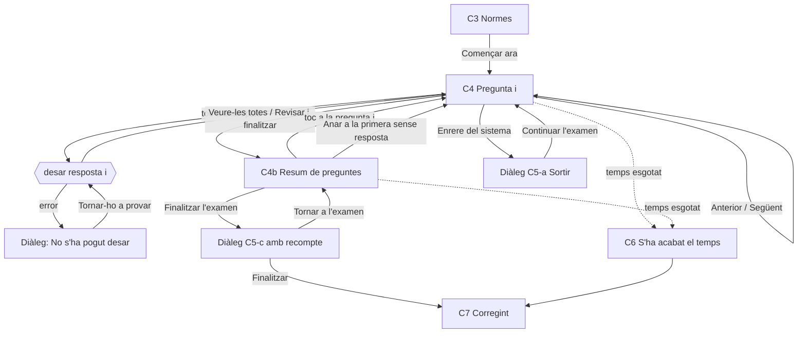

# Revisión UX — `app-candidate`, hito 1 (implementado)

> Autor: `ux-designer` · Fecha: 2026-11-20 · Alcance: flujo del candidato implementado en el hito 1
> (C0–C11), con el foco que pidió el usuario: (1) tipos de pregunta inconfundibles, (2) **navegación
> libre** (decisión del usuario, `AGENTS.md` «Navegación del examen»), (3) revisión franca del flujo, el
> microcopy, la fuente al 200 %, el modo oscuro, el resultado, el repaso y la credencial.
> La revisión visual (paleta, tipografía, componentes) va en un documento aparte de `ui-designer`; aquí
> solo se tocan aspectos visuales cuando cambian el significado o la usabilidad.
>
> **No se modifica ningún ADR ni ARB1.** Nada de lo propuesto toca el token, la firma ni el
> contrato de emisión; solo el motor del examen (`core-exam`), el ViewModel y la UI.
>
> Convención: **[H]** hecho verificado (captura o `fichero:línea`) · **[S]** propuesta o suposición
> propia · **[PV]** pendiente de verificar en un dispositivo · **MUST / SHOULD / COULD** = prioridad
> de implementación.

## Fuentes revisadas

- 21 capturas reales en `C:\msys64\tmp\shots\` (1080×2400, tema claro salvo `19-result-dark.png`;
  `18-…` y `20-…` con escala de fuente al 200 %). Banco de muestra `[FICTICI]`: 5 preguntas, 5 min y
  umbral 3.
- `AGENTS.md` (decisión de navegación libre del 2026-11-20); `docs/design/04-ux.md` §1–§2, §7 y §8;
  `03-arquitectura-movil.md` §4.2–§4.5; `01-requisitos.md` §1.3, §2.1 y §3.1.
- Código: `app-candidate/src/main/kotlin/dev/lluissunol/arbitratge/ui/*.kt`, `res/values/strings.xml`,
  `core-exam/.../ExamEngine.kt`, `BankValidator.kt`.

**Lagunas de evidencia** [H]: no hay captura de (a) resultado **suspendido** (`17-result-failed.png`
muestra en realidad el diálogo «No has marcat cap resposta» en la pregunta 5), (b) el diálogo de
salida (`11-exit-dialog-or-back.png` es idéntico a `12-home-passed.png`), (c) los avisos de 5 y 1 min
(con un límite de 5 min, el de 5 min no aplica), (d) el fallo de guardado, (e) el modo oscuro en la
pregunta, el repaso y la credencial, ni (f) ninguna pasada con TalkBack. Las conclusiones sobre esos
estados salen del código, no de capturas.

---

## 0. Resumen

Lo bueno: el hito 1 cumple la estructura de `04`. Hay una acción primaria por pantalla, el botón va
abajo y a todo el ancho, los textos están en catalán claro, el modo presentación tiene fondo blanco,
la credencial no muestra ningún veredicto «VÀLIDA» (T5) y el nombre se confirma antes de empezar.
Los cimientos aguantan.

Lo que no puede salir así (en orden):

1. **El repaso de una pregunta múltiple fallada engaña** (F2): si faltó marcar una opción
   correcta, «La teva resposta» solo muestra ✔ verdes y nada explica el fallo. Es el núcleo
   pedagógico del producto.
2. **La navegación implementada es la secuencial antigua** (F1): las normas dicen «No podràs tornar
   a una pregunta anterior», el diálogo sin respuesta dice «no podràs tornar-hi» y el motor rechaza
   el retroceso (`ExamEngine.kt:129-130`, `BankValidator.kt:91`). La nueva decisión exige rehacer el
   bucle del examen: Anterior/Següent, una pantalla de resumen, finalizar solo de forma explícita y
   una confirmación final con el número de preguntas sin responder (§2).
3. **Los tres tipos de pregunta no se distinguen lo bastante** (F3): opción única y Vertader/Fals son
   idénticas, y la múltiple solo se diferencia por una casilla pequeña y una frase de ayuda con el
   mismo estilo que el resto del texto.
4. **El verde de «marcada» se confunde con el verde de «correcta»** (F4).
5. **A 200 %** se rompe la cabecera del examen («Pregunta 5 de / 5») y peligran los títulos largos
   de la barra superior (F6).

---

## 1. Hallazgos ordenados

Severidad: **P0** = induce a error o contradice una decisión vigente · **P1** = fricción importante o
problema de accesibilidad · **P2** = pulido.

| # | Sev. | Hallazgo | Evidencia |
|---|---|---|---|
| F1 | P0 | **Navegación secuencial todavía activa y comunicada al usuario.** Normas: «No podràs tornar a una pregunta anterior». Diálogo sin respuesta: «…no podràs tornar-hi». El motor solo acepta `index == currentIndex` y prohíbe responder dos veces; el validador exige `sequential=true`; la última respuesta guardada **finaliza automáticamente** el examen. | `05-rules.png`, `07-…png`; `strings.xml:26,55`; `ExamEngine.kt:125-130`; `BankValidator.kt:91`; `ExamViewModel` `persistAnswer` (`last` ⇒ `Finish`) |
| F2 | P0 | **El repaso no explica el fallo en la respuesta múltiple.** En `14-review-detail.png`, la pregunta «Fallada» muestra en «La teva resposta» una sola opción con ✔ «Correcta, la vas marcar». La causa (faltaba otra correcta) solo se deduce comparando con la lista de abajo. Además no se ven las opciones incorrectas no marcadas, no se indica el tipo de pregunta y el estado «Fallada» solo aparece en el título de la barra. | `ScreensResult.kt` `QuestionDetail` |
| F3 | P0 | **Tipos de pregunta poco diferenciados.** `single_choice` y `true_false` se ven igual (radio + «Tria una resposta.»). En V/F el enunciado es una afirmación, pero nada pide juzgarla. En `multiple_choice` el aviso «Marca totes les respostes correctes…» va en el mismo estilo de cuerpo, debajo de un enunciado de 22 sp, y se lo salta la vista. No hay ninguna etiqueta del tipo. | `06-…`, `q-truefalse.png`, `q-single-selected.png`, `q-multi-selected.png`; `QuestionScreen.kt:89-92` |
| F4 | P1 | **«Marcada» y «correcta» comparten color.** La opción marcada usa `primaryContainer` (verde claro) con borde verde, y en el repaso ✔ «Correcta» también es verde primario. Un usuario mayor puede leer «se ha puesto verde ⇒ la he acertado». | `QuestionScreen.kt:252`; `ScreensResult.kt` `VerdictRow` (`tint = primary`) |
| F5 | P1 | **Doble diálogo al final y confirmación sin datos.** En la última pregunta sin responder aparece primero «No has marcat cap resposta» y después «Vols finalitzar l'examen?». La confirmación final no dice cuántas preguntas quedan sin responder. | `17-…png`, `20-…png`, `q-finish-dialog.png`; `ExamViewModel.kt:361,371` |
| F6 | P1 | **200 %:** la cabecera parte «Pregunta 5 de / 5» porque el cronómetro le quita ancho. La `TopAppBar` tiene altura fija y los títulos largos («Pregunta 2 de 5 · Fallada», «La teva credencial») pueden recortarse [PV]. El texto de los botones con dos líneas queda alineado a la izquierda («Repassar les 2 / preguntes fallades»). | `20-…png`, `18-…png`; `QuestionScreen.kt:179`; `Components.kt` `PrimaryButton`/`SecondaryButton` |
| F7 | P1 | **La lista del repaso desordena y no se escanea bien.** «Totes» pone los fallos primero (`sortedBy { isCorrect }`) y rompe la numeración. Las filas no llevan icono de estado ni chevron. Con un solo elemento, «‹ Anterior / Següent ›» deshabilitados casi no se ven, pero ocupan la zona del pulgar. | `13-…`, `14-…png`; `ScreensResult.kt:153,163-164` |
| F8 | P1 | **El cronómetro muestra segundos que saltan desde el inicio**, en contra de `04` §2.4 («sense segons saltant»; `mm min` hasta el último minuto). El gesto de ocultar el tiempo no se descubre: es una píldora sin pista y TalkBack no anuncia la acción. | `06-…png`; `QuestionScreen.kt:201` |
| F9 | P1 | **El resultado no desglosa las preguntas sin responder.** «Fallades: 2» suma las erróneas y las sin responder (`failures`). Con navegación libre y fin por tiempo, el candidato necesita ver «(1 sense resposta)». | `10-result.png`; `ScreensResult.kt` |
| F10 | P1 | **Modo presentación: el texto de ayuda no deja claro a quién habla.** «Per verificar-la: obre l'adreça oficial del verificador al teu mòbil» sale en el móvil del candidato, y «al teu mòbil» se refiere a otra persona. «APTE · …» se arma concatenando y quitando un prefijo («removePrefix("Examen: ")»), lo que es frágil para localizar. | `16-presentation.png`; `strings.xml:131`; `ScreensCredential.kt:78` |
| F11 | P1 | **Inicio ambiguo si aprobó antes y suspendió después.** La tarjeta pasa a «✔ Has aprovat» sin nota, y «Repassar l'últim examen» abre el examen **suspendido**. Hay dos verdades mezcladas en una tarjeta. | `ScreensMain.kt` `HomeScreen` |
| F12 | P1 | **La credencial no permite compartir, guardar el PDF ni copiar el código** (`04` §3.4). Si es alcance de un hito posterior, está bien, pero el candidato todavía no tiene una copia portable. | `15-credential.png`; `ScreensCredential.kt` |
| F13 | P2 | La bienvenida es un bloque de seis líneas; `04` §2.2 pedía viñetas. | `01-welcome.png` |
| F14 | P2 | «Pots **practicar** tantes vegades com vulguis» sugiere un modo práctica, y cada intento es un examen real que puede emitir credencial. | `02-home-empty.png` |
| F15 | P2 | En el nombre, la tecla «Fet» del teclado solo cierra el teclado y no lanza «Continuar» (no hay `keyboardActions`). | `ScreensMain.kt` `NameScreen` |
| F16 | P2 | TalkBack: el `stateDescription` propio («seleccionada») se suma al estado nativo de `selectable/toggleable` y puede leerse dos veces [PV]. El cronómetro no tiene `onClickLabel`. | `QuestionScreen.kt:253` |
| F17 | P2 | Hay tres términos para lo mismo: «sense respondre», «no vas respondre» y «has contestat»/«que falten». Conviene unificar. | `strings.xml:63,99,…` |
| F18 | P2 (visual) | En las tarjetas de opción, el texto de una línea queda arriba con un hueco debajo, y la alineación del radio cambia entre una y dos líneas. La barra de progreso tiene un punto final (*stop indicator*). Los emojis de las normas (❓ rojo) desentonan. → para `ui-designer`. | `q-single-selected.png`, `05-rules.png` |

---

## 2. Especificación: navegación libre (sustituye «secuencial sin retroceso»)

### 2.1 Reglas de comportamiento

| ID | Prio | Regla |
|---|---|---|
| N1 | MUST | El candidato puede ir a **cualquier pregunta** (Anterior, Següent o desde el resumen) y **cambiar cualquier respuesta** mientras el examen esté `IN_PROGRESS`. |
| N2 | MUST | **Nada termina el examen salvo** (a) «Finalitzar» confirmado o (b) el tiempo agotado. Responder la última pregunta **ya no** finaliza. |
| N3 | MUST | **Persistir antes de avanzar (B3) se mantiene:** no se cambia de pregunta, no se abre el resumen y no se finaliza mientras la selección visible de la pregunta actual no esté guardada. Si falla el guardado, se usa el diálogo modal actual («No s'ha pogut desar» + Tornar-ho a provar / Sortir de l'examen) y la selección **sigue visible**. |
| N4 | MUST | **Guardado.** Ver la decisión abierta P1: la recomendación es **guardar cada toque** (upsert de `answer(session, i)`); la alternativa es guardar al salir de la pregunta. Con la recomendada, el cambio de pantalla es instantáneo porque ya está guardado, y si el proceso muere solo se pierde el último toque en vuelo. |
| N5 | MUST | `remaining_at_tap` se captura **en cada cambio** de selección. Un toque con tiempo `< 0` se rechaza y lleva a «S'ha acabat el temps». Al agotarse el tiempo se corrige con lo guardado; un toque en vuelo con tiempo ≥ 0 se guarda antes (regla vigente de `03` §4.3). |
| N6 | MUST | **Sin respuesta = fallo** (sin cambios). «Següent» con la pregunta vacía **avanza sin diálogo**: el diálogo «No has marcat cap resposta» **se elimina**. El aviso pasa al resumen y a la confirmación final. |
| N7 | MUST | Una casilla múltiple se puede desmarcar hasta quedar vacía, que equivale a «sense resposta». La opción única y V/F no se pueden vaciar una vez marcadas, como cualquier radio (ver COULD C3). |
| N8 | MUST | Al reanudar (cierre, muerte del proceso o reinicio) se vuelve a la **última pregunta visitada** (`current_index` persistido = posición) con sus respuestas restauradas. |
| N9 | MUST | **Sin gestos de deslizar** entre preguntas: un deslizamiento accidental cambiaría de pregunta sin querer (`04` §8.2: «sense swipe obligatori»). Solo botones. |
| N10 | MUST | **Atrás del sistema** abre el diálogo «Vols sortir de l'examen?» igual que ahora; **no** retrocede de pregunta (decisión abierta P2). Para ir atrás está el botón visible «Anterior». |
| N11 | MUST | El reloj y los avisos de 5 y 1 min siguen visibles y activos también en la pantalla de resumen. |
| N12 | SHOULD | En la última pregunta, el botón derecho dice **«Revisar i finalitzar»** y abre el resumen; «Finalitzar l'examen» es el primario del resumen y pide confirmación (decisión abierta P3). |
| N13 | COULD | «Marcar per revisar» (bandera por pregunta, visible en el resumen). Útil, pero añade un concepto; mejor medirlo en pruebas con usuarios antes. |

### 2.2 Flujo



### 2.3 Wireframes

**C4: pregunta (estructura común nueva)**

```
┌──────────────────────────────────────┐
│ Pregunta 3 de 20            ⏱ 18 min │  ← fila 1 (en 200 %: el cronòmetre baixa a una 2a fila)
│ Respostes: 12 de 20    ( Veure-les totes ) │  ← fila 2: progrés de RESPOSTES, no de posició
│ ▓▓▓▓▓▓▓▓▓▓▓▓░░░░░░░░                 │  ← barra = respostes/total (decorativa per a TalkBack)
├──────────────────────────────────────┤
│ ┌──────────────────────┐             │
│ │ ☑☑ Resposta múltiple │             │  ← etiqueta de tipus (icona + text), sempre
│ └──────────────────────┘             │
│ [FICTICI] Quins d'aquests animals…   │  ← enunciat 22 sp
│ ┌──────────────────────────────────┐ │
│ │ ⓘ Marca totes les respostes      │ │  ← caixa d'ajuda destacada (només múltiple)
│ │   correctes. Pots marcar-ne més   │ │
│ │   d'una.                          │ │
│ └──────────────────────────────────┘ │
│ ┌──────────────────────────────────┐ │
│ │ ☐  La tortuga astronauta         │ │
│ └──────────────────────────────────┘ │
│ ┌──────────────────────────────────┐ │
│ │ ☑  El pop pianista               │ │  ← marcada: vora gruixuda + control ple;
│ └──────────────────────────────────┘ │    color NO verd-èxit (F4)
│ 2 respostes marcades                 │
├──────────────────────────────────────┤
│ ( ‹ Anterior )      [ Següent › ]    │  ← 2 botons ≥ 56 dp; en 200 %, apilats
└──────────────────────────────────────┘    (Següent a dalt)
```

- Pregunta 1: «Anterior» se ve **deshabilitado** (no se oculta, para que el diseño no salte).
- Última pregunta: `[ Revisar i finalitzar ]` en lugar de «Següent ›».
- El cronómetro pasa a «⏱ 18 min»; en el último minuto, a «⚠ 00:59» (F8, `04` §2.4).

**Etiqueta de tipo y ayuda (resuelve F3)**

| Tipo | Etiqueta (icono + texto) | Ayuda | Controles |
|---|---|---|---|
| `single_choice` | ◉ **Una resposta** | «Tria una resposta.» | Radio |
| `multiple_choice` | ☑☑ **Resposta múltiple** | Caja destacada: «Marca totes les respostes correctes. Pots marcar-ne més d'una.» + recuento «N respostes marcades» | Casillas cuadradas |
| `true_false` | ⚖ **Vertader o fals** | «Llegeix l'afirmació i digues si és vertadera o falsa.» | Dos tarjetas grandes «Vertader» / «Fals» (radio) |

Regla [S]: el tipo se comunica por **tres canales a la vez**: etiqueta con texto, forma del control
(círculo o cuadrado) y frase de ayuda. Nunca solo por la forma del control. Además, las normas de C3
avisan de antemano de que hay preguntas con varias respuestas correctas.

**C4b: resumen de preguntas (pantalla completa, no hoja inferior)**

```
┌──────────────────────────────────────┐
│ ←  Preguntes de l'examen     ⏱ 18 min│
├──────────────────────────────────────┤
│ Has respost 17 de 20 preguntes.      │
│ Et falten 3 preguntes per respondre. │  ← en negreta; si 0: "Has respost totes les preguntes."
│                                      │
│ ┌──────────────────────────────────┐ │
│ │ ●  Pregunta 1 · Resposta desada  │ │  ← ● ple = amb resposta (NO ✔: ✔ vol dir "correcta")
│ │    Quants corns pot tenir…       │ │  ← 1a línia de l'enunciat (màx. 2 línies)
│ └──────────────────────────────────┘ │
│ ┌──────────────────────────────────┐ │
│ │ ○  Pregunta 2 · Sense resposta   │ │  ← ○ buit + text en negreta
│ │    Quins elements són…           │ │
│ └──────────────────────────────────┘ │
│ ┌──────────────────────────────────┐ │
│ │ ●  Pregunta 3 · Ets aquí         │ │  ← la pregunta des d'on s'ha vingut
│ └──────────────────────────────────┘ │
│  …                                   │
├──────────────────────────────────────┤
│ ( Anar a la primera sense resposta ) │  ← només si en falta alguna
│ [ Finalitzar l'examen ]              │
└──────────────────────────────────────┘
```

- **Lista, no cuadrícula** [S]: con 20 preguntas y la fuente al 200 %, una cuadrícula de números
  pierde la etiqueta de texto y obliga a recordar qué era la «7». La primera línea del enunciado ayuda
  a encontrar la pregunta (decisión abierta P5).
- Tocar una fila lleva a esa pregunta. ← y Atrás del sistema devuelven a la pregunta de origen.
- TalkBack: cada fila es un único elemento: «Pregunta 2, sense resposta. Quins elements són…
  Toca per anar-hi».

**C5-c: confirmación final (sustituye el diálogo actual y elimina C5-b)**

```
Con preguntas sin responder               Con todo respondido
┌──────────────────────────────────┐      ┌──────────────────────────────────┐
│ Vols finalitzar l'examen?        │      │ Vols finalitzar l'examen?        │
│ Tens 3 preguntes sense resposta: │      │ Has respost totes les preguntes. │
│ comptaran com a fallades.        │      │ Després de finalitzar ja no      │
│ Després de finalitzar ja no      │      │ podràs canviar cap resposta.     │
│ podràs canviar cap resposta.     │      │                                  │
│ ( Finalitzar ) [ Tornar a l'examen ]│   │ ( Finalitzar ) [ Tornar a l'examen ]│
└──────────────────────────────────┘      └──────────────────────────────────┘
```

Se mantiene la regla de `04` §2.4: la acción **segura** va en el hueco de confirmación y la
irreversible en el secundario. El texto del botón seguro pasa de «Revisar» a «Tornar a l'examen»,
porque «Revisar» se confunde con «Repassar» del final. Desde aquí, **«Revisar» se usa solo durante el
examen y «Repassar» solo después.**

**C5-a: salir (Atrás del sistema)**: el mismo diálogo, con texto que tranquiliza:
«El temps continua passant. Les respostes ja estan desades: quan tornis a obrir l'app, podràs
continuar.» Botones: [ Continuar l'examen ] (seguro) / ( Sortir ).

### 2.4 Accesibilidad específica de la navegación

| Prio | Requisito |
|---|---|
| MUST | Al cambiar de pregunta, el foco va a la cabecera y TalkBack lee: «Pregunta 3 de 20. Resposta múltiple. Resposta desada» o «… Sense resposta». |
| MUST | **200 %:** la cabecera se convierte en dos filas (progreso y, debajo, cronómetro y «Veure-les totes»). Anterior y Següent se apilan (Següent arriba). El texto de los botones va centrado (`textAlign = Center`). Nada de alturas fijas. |
| MUST | Tamaño táctil: filas del resumen, botones de navegación y etiqueta de tipo informativa (no táctil) ≥ 56 dp en lo pulsable. |
| SHOULD | La píldora del cronómetro lleva `onClickLabel` («amagar el temps» / «mostrar el temps») y un texto visible «Amagar» en el primer uso, o una pista en C3. |
| SHOULD | Quitar el `stateDescription` propio de `OptionCard` si el rol nativo ya anuncia «seleccionat/marcat» (comprobar con TalkBack, F16). |

---

## 3. Especificación: resto de pantallas

### 3.1 C3: normas (MUST, porque F1 las deja falsas)

```
⏱ Tens 30 minuts en total.
❓ Són 20 preguntes.
↔ Pots anar endavant i enrere i canviar les respostes fins que finalitzis.
☑ Algunes preguntes tenen més d'una resposta correcta: t'ho indicarem.
○ Les preguntes sense resposta compten com a fallades.
✔ Per aprovar cal encertar-ne 14.
💾 Les respostes es desen automàticament.
⚠ Si surts de l'app, el temps continua passant.
```

Siete u ocho líneas son el máximo razonable. Si se considera excesivo, «es desen automàticament» se
puede fundir con la línea de salir (decisión de pruebas con usuarios). Iconos: los decide `ui-designer`
(sin emojis de colores).

### 3.2 C8/C9: resultado

| Prio | Cambio |
|---|---|
| MUST | Desglose: «Fallades: 3 (1 sense resposta)» cuando `unanswered > 0` (F9). |
| SHOULD | El texto de los botones con dos líneas va centrado (F6). |
| SHOULD | Capturar y revisar C9 (suspendido): no hay evidencia (laguna a). |
| COULD | Icono del titular a 32–40 dp que escale con la fuente; ahora es de 24 dp fijo y a 200 % queda diminuto (`18-…png`). Es tema visual. |

### 3.3 C10: repaso (resuelve F2 y F7)

**Detalle (MUST)**: una sola lista con **todas las opciones en el orden mostrado** y, en cada una, lo
que hizo el candidato junto con el veredicto. Encima, una frase que **explica el fallo**.

```
┌──────────────────────────────────────┐
│ ←  Repàs                             │  ← títol curt (no "Pregunta 2 de 5 · Fallada": 200 %)
├──────────────────────────────────────┤
│ Pregunta 2 de 5                      │
│ ✖ Fallada · ☑☑ Resposta múltiple     │  ← estat + tipus en el contingut, icona + text
│ [FICTICI] Què és imprescindible per  │
│ inflar un globus de mostra?          │
│ ┌──────────────────────────────────┐ │
│ │ No vas marcar 1 resposta correcta.│ │  ← per què ha fallat (calculat)
│ └──────────────────────────────────┘ │
│ ☑  Una bomba d'aire imaginària   ✔   │
│    Correcta · la vas marcar          │
│ ☐  Un sospir de mostra           ✔   │  ← la que faltava: realçada (vora/fons d'avís)
│    Correcta · no la vas marcar       │
│ ☐  Un pal de fusta               —   │
│    Incorrecta · no la vas marcar     │  ← atenuada però llegible (≥ 4,5:1)
│                                      │
│ Per què?                             │  ← només si hi ha explanation
│ …                                    │
├──────────────────────────────────────┤
│ ( ‹ Anterior )      ( Següent › )    │  ← amagats si la llista té 1 element
└──────────────────────────────────────┘
```

Frase de motivo (calculada a partir de `selectedIds` y `correctIds`):

| Caso | Texto |
|---|---|
| Acertada | «L'has encertada.» |
| Sin responder | «No la vas respondre: compta com a fallada.» |
| Faltan correctas (y ninguna incorrecta) | «No vas marcar {n} resposta(es) correcta(es).» |
| Sobran incorrectas (y no falta ninguna) | «Vas marcar {n} resposta(es) incorrecta(es).» |
| Ambas cosas | «Vas marcar {a} resposta(es) incorrecta(es) i no vas marcar {b} de correcta(es).» |
| Única o V/F errónea | «La teva resposta no era la correcta.» |

**Lista (SHOULD)**: «Totes» en **orden natural** (1…N). Cada fila lleva icono y texto de estado
(✔ Encertada / ✖ Fallada / ○ Sense resposta) y un chevron. El filtro «Fallades» sigue saliendo por
defecto.

### 3.4 C0: inicio (SHOULD, F11 y F14)

- Tarjeta de credencial y último intento **separadas**: «Tens la credencial d'aptitud» (con
  [ Veure la credencial ]) y, debajo, «Últim examen: 2 de 5 encerts (no aprovat)» + «Repassar l'últim
  examen».
- `home_empty`: «Encara no has fet cap examen. El pots fer tantes vegades com vulguis.»

### 3.5 C11 y modo presentación

| Prio | Cambio |
|---|---|
| MUST | Cadena propia para «APTE · reglament {v}» (sin `removePrefix`, F10). |
| SHOULD | Ayuda de verificación sin «al teu mòbil»: «Per comprovar-la: obre el verificador oficial des de la seva icona (no des d'un enllaç rebut) i escaneja aquest codi.» Es coherente con el aviso anti-suplantación de `04` §5.7. |
| SHOULD | Confirmar en qué hito llegan Compartir, Desar PDF y «Copiar el codi de verificació» (F12). Hasta entonces, la pérdida del móvil implica perder la credencial. |
| [PV] | Comprobar en un dispositivo real que el brillo sube al máximo y se restaura al cerrar, y probar el modo presentación con el tema oscuro del sistema. |

### 3.6 Otros (COULD)

- C1 con viñetas (F13). Nombre: «Fet» del teclado = «Continuar» (F15).
- C3. Botón «Esborrar la resposta» en opción única y V/F, para quien quiera dejarla en blanco.
  Pedagógicamente casi no aporta (en blanco también es fallo), así que solo se haría si las pruebas
  con usuarios lo piden.
- Selección (F4): la UX exige que el estado «marcada» (a) no dependa solo del color y (b) **no use el
  mismo token que «correcta»** del repaso. Tono y token concretos: `ui-designer`.

---

## 4. Microcopy en catalán (cambios)

Unificación (F17): verbo **respondre**; estados **«Resposta desada»** y **«Sense resposta»**;
**«Revisar»** solo durante el examen y **«Repassar»** solo después.

| Clave | Estado | Texto |
|---|---|---|
| `rules_count` | cambia | Són %1$d preguntes. |
| `rules_noback` | **se elimina** | — |
| `rules_nav` | nueva | Pots anar endavant i enrere i canviar les respostes fins que finalitzis. |
| `rules_types` | nueva | Algunes preguntes tenen més d'una resposta correcta: t'ho indicarem. |
| `rules_unanswered` | nueva | Les preguntes sense resposta compten com a fallades. |
| `rules_autosave` | nueva | Les respostes es desen automàticament. |
| `q_type_single` | nueva | Una resposta |
| `q_type_multi` | nueva | Resposta múltiple |
| `q_type_tf` | nueva | Vertader o fals |
| `tf_hint` | nueva | Llegeix l'afirmació i digues si és vertadera o falsa. |
| `single_hint` / `multi_hint` | se mantienen | Tria una resposta. / Marca totes les respostes correctes. Pots marcar-ne més d'una. *(P4)* |
| `answered_progress` | nueva | Respostes: %1$d de %2$d |
| `btn_overview` | nueva | Veure-les totes *(a11y: «Veure totes les preguntes»)* |
| `btn_prev_q` / `btn_next` | nueva / se mantiene | ‹ Anterior / Següent › |
| `btn_review_finish` | nueva | Revisar i finalitzar |
| `overview_title` | nueva | Preguntes de l'examen |
| `overview_answered` | nueva (plural) | Has respost %1$d de %2$d preguntes. |
| `overview_missing` | nueva (plural) | one: Et falta 1 pregunta per respondre. · other: Et falten %d preguntes per respondre. |
| `overview_all` | nueva | Has respost totes les preguntes. |
| `q_state_answered` / `q_state_empty` / `q_state_here` | nuevas | Resposta desada / Sense resposta / Ets aquí |
| `btn_first_empty` | nueva | Anar a la primera sense resposta |
| `finish_body_missing` | nueva (plural) | one: Tens 1 pregunta sense resposta: comptarà com a fallada. · other: Tens %d preguntes sense resposta: comptaran com a fallades. |
| `finish_body_all` | nueva | Has respost totes les preguntes. |
| `finish_body` | cambia | Després de finalitzar ja no podràs canviar cap resposta. |
| `btn_review_q` | cambia | Tornar a l'examen *(antes «Revisar»)* |
| `noanswer_title` / `noanswer_body` / `btn_mark` / `btn_continue_anyway` | **se eliminan** | — |
| `exit_body` | cambia | El temps continua passant. Les respostes ja estan desades: quan tornis a obrir l'app, podràs continuar. |
| `btn_continue` (diálogo de salida) | cambia | Continuar l'examen |
| `timeup_body` | cambia (plural) | Has respost %1$d de %2$d preguntes. one: La que no té resposta compta com a fallada. · other: Les %3$d sense resposta compten com a fallades. |
| `result_wrong_detail` | nueva | Fallades: %1$d (%2$d sense resposta) |
| `q_unanswered` | cambia | Sense resposta |
| `review_ok` | nueva | L'has encertada. |
| `review_empty_q` | nueva | No la vas respondre: compta com a fallada. |
| `review_missed` | nueva (plural) | one: No vas marcar 1 resposta correcta. · other: No vas marcar %d respostes correctes. |
| `review_extra` | nueva (plural) | one: Vas marcar 1 resposta incorrecta. · other: Vas marcar %d respostes incorrectes. |
| `review_wrong_single` | nueva | La teva resposta no era la correcta. |
| `opt_right_marked` / `opt_right_missed` / `opt_wrong_marked` | cambian (formato) | Correcta · la vas marcar / Correcta · no la vas marcar / Incorrecta · la vas marcar |
| `opt_wrong_unmarked` | nueva | Incorrecta · no la vas marcar |
| `home_empty` | cambia | Encara no has fet cap examen. El pots fer tantes vegades com vulguis. |
| `home_has_cred` | nueva | Tens la credencial d'aptitud. |
| `last_failed` | cambia | Últim examen: %1$d de %2$d encerts (no aprovat). |
| `present_result` | nueva | APTE · reglament %1$s |
| `cred_how_to` | cambia | Per comprovar-la: obre el verificador oficial des de la seva icona (no des d'un enllaç rebut) i escaneja aquest codi. |
| `time_toggle_hide` / `time_toggle_show` | nuevas (`onClickLabel`) | amagar el temps / mostrar el temps |
| `time_minutes` | nueva | ⏱ %1$d min *(per sobre d'1 minut; després «⚠ mm:ss»)* |

---

## 5. Impacto técnico (para `android-developer`; no cambia ADR ni ARB1)

- `ExamEngine.answer`: aceptar **cualquier índice** y **sobrescribir** (upsert) mientras
  `IN_PROGRESS`; quitar `OUT_OF_ORDER` y `ALREADY_ANSWERED` del modo examen. Mantener `TIME_EXPIRED`
  e `INVALID_SELECTION`. Selección vacía = sin respuesta.
- `ExamSession.currentIndex` deja de ser «la primera sin responder». Hacen falta `position`
  (persistida, la última pregunta visitada) y `answeredCount` (respuestas con selección no vacía).
  `isComplete` ya no dispara el final.
- Nuevo evento de dominio `finish(session)`: una transacción con `state = FINISHED(COMPLETED)` +
  `correct_count`, precedida del guardado de la selección pendiente.
- `ExamRules.sequential`: aceptar `false` y usarlo como valor por defecto, o sustituirlo por
  `navigation = FREE`. Retirar o invertir `SEQUENTIAL_REQUIRED` en `BankValidator`. Es un cambio de
  esquema del banco: lo coordina `bank-curator`.
- `Stage.Question`: añadir `answered: Set<Int>` y `canGoBack`. Nuevo `Stage.Overview`. Quitar
  `QuestionDialog.NO_ANSWER` y `afterNoAnswerFinish`.
- Tests mínimos: cambiar una respuesta anterior y que la corrección use la última; muerte del proceso
  con el resumen abierto; tiempo agotado con un toque en vuelo; finalizar con preguntas sin responder;
  navegación bloqueada mientras se guarda; reanudar en la posición visitada; recálculo del repaso con
  respuestas sobrescritas.

---

## 6. Cambios necesarios en la documentación

| Doc | Sección | Cambio |
|---|---|---|
| `01` | §1.3, fila «Navegación secuencial sin retroceso» (l. ~127) | → «**Adapta: navegación libre** hasta finalizar (decisión del usuario, 2026-11-20); sin respuesta = fallo; persistir antes de avanzar». |
| `01` | §2.1 CU-C3 | «(…sin retroceso)» → «(navegación libre; sin respuesta = fallo)». |
| `01` | §3.1 pasos 1, 4 y 5 | Normas sin «no se puede volver atrás». Paso 4: «guardado en cada cambio; Anterior/Següent/resumen». Paso 5: «Fin: Finalitzar confirmado o tiempo agotado». |
| `01` | Preguntas abiertas 4 (l. ~447) | Marcar como resuelta la parte de la navegación. |
| `03` | §4.3 máquina de estados | Sustituir `InProgress(i) → InProgress(i+1)` por `InProgress(i) → InProgress(j)` (tras guardar), añadir `SaveAnswer(i)` (upsert) y `Finish` explícito. Eliminar «la última respuesta finaliza». Línea «Navegación: secuencial sin retroceso por defecto» → libre. |
| `03` | §4.4 `session`/`answer` | `current_index` = posición visitada; `answer` admite upsert y `remaining_at_tap` del último cambio. |
| `03` | §4.5 muerte del proceso | «Se reanuda en la última pregunta visitada con sus respuestas; solo se pierde el toque en vuelo». |
| `03` | §5.2/§5.3 reglas del banco | `sequential` / `SEQUENTIAL_REQUIRED` (ver §5). |
| `03` | §11 pruebas | Añadir las de §5. |
| `04` | §1.1 y §1.2 | Añadir **C4b Resum de preguntes**; diagrama de §2.2; nota de que Atrás abre C5-a. |
| `04` | §2.3 | Normas nuevas (§3.1). |
| `04` | §2.4 | Etiqueta de tipo + ayuda V/F; barra Anterior/Següent; «Revisar i finalitzar»; **eliminar C5-b**; C5-c con recuento; C5-a con «respostes desades»; sin gestos de deslizar; cronómetro en «min». |
| `04` | §2.5, §2.7 y §2.9 | `timeup_body` plural; desglose de las sin responder; detalle del repaso con lista única y frase de motivo; orden natural en «Totes». |
| `04` | §3.3 | Texto de ayuda de verificación nuevo. |
| `04` | §7.1–§7.4 | Tabla de §4. |
| `04` | §8.2 | Anuncio de TalkBack al cambiar de pregunta; cabecera a 200 %; texto centrado en los botones; «marcada» ≠ «correcta». |

---

## 7. Riesgos residuales

- **Persistencia en cada toque** [S]: con ~20–60 escrituras por examen el coste es despreciable
  (`03` §4.4), pero un almacenamiento lento podría notarse como un pequeño retraso al navegar. [PV]
  medirlo en un móvil de gama baja.
- **Cambio de esquema del banco** (`sequential`): exige coordinar con `bank-curator` para que un banco
  antiguo no rompa el arranque (`BuildError`).
- **Carga cognitiva del resumen**: es una pantalla más. Sin pruebas con usuarios mayores no se sabe si
  lo entienden a la primera.
- **Lagunas de evidencia** (suspendido, salida, avisos de tiempo, oscuro en pregunta/repaso/credencial,
  TalkBack, error de guardado): pueden esconder defectos no listados.
- Revelar o no que la múltiple tiene ≥ 2 correctas cambia la dificultad del examen (P4).

---

## Preguntas abiertas para el usuario

1. **P1, guardado**: ¿guardar **en cada toque** (recomendado: nada se pierde y la navegación es
   instantánea) o solo **al salir de la pregunta** (menos escrituras, pero si la app muere se pierde
   la selección actual)?
2. **P2, Atrás del sistema**: ¿abre el diálogo «Vols sortir?» (recomendado: predecible; el retroceso
   está en el botón visible) o va a la pregunta anterior y solo desde la pregunta 1 ofrece salir? Lo segundo
   es más «natural» en Android, pero algunos usuarios saldrían sin querer o se perderían.
3. **P3, cerrar el examen**: en la última pregunta, ¿«Revisar i finalitzar» abre el resumen y desde
   allí se confirma (recomendado, 3 toques), o «Finalitzar l'examen» abre directamente la confirmación
   con el recuento (2 toques)?
4. **P4, pista de la múltiple**: ¿se dice «n'hi ha més d'una de correcta» (verdad según el banco:
   `multiple_choice` ≥ 2) o se mantiene la frase neutra «Pots marcar-ne més d'una»? La primera ayuda a
   los mayores; la segunda mantiene la dificultad actual.
5. **P5, formato del resumen**: ¿lista con la primera línea del enunciado (recomendado) o cuadrícula
   de números (más compacta, peor a 200 %)?
6. ¿Queremos **«Marcar per revisar»** (bandera) en el MVP o se decide tras las pruebas con usuarios?
7. **Cronómetro**: ¿«18 min» hasta el último minuto, como pide `04` §2.4 (recomendado), o `mm:ss`
   siempre, como ahora?
8. ¿En qué hito llegan **Compartir / Desar PDF / Copiar el codi** de la credencial?
9. ¿El repaso debe mostrar las **acertadas** por defecto o solo bajo «Totes», como ahora? (`01`
   pregunta 4, parte editorial).
10. ¿Se ofrece un **«Abandonar l'examen»** explícito, o basta con salir y dejar que se agote el tiempo?
